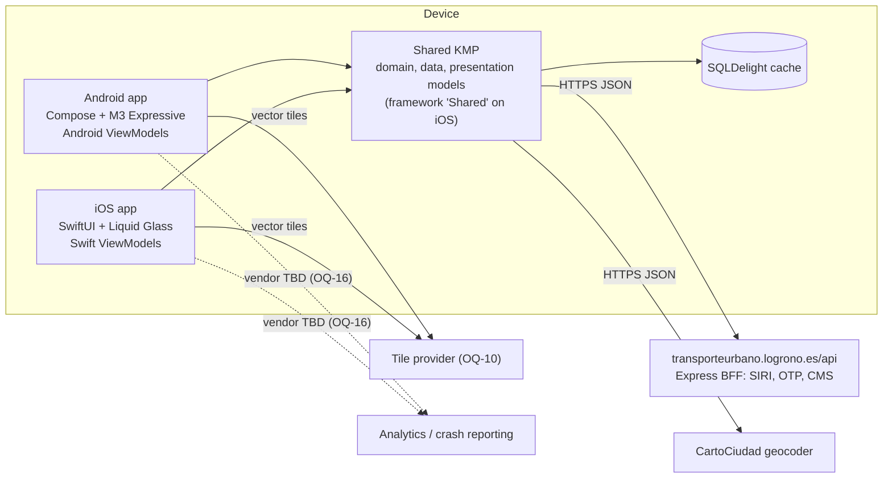
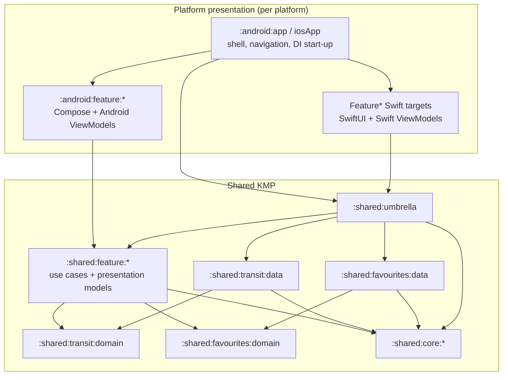
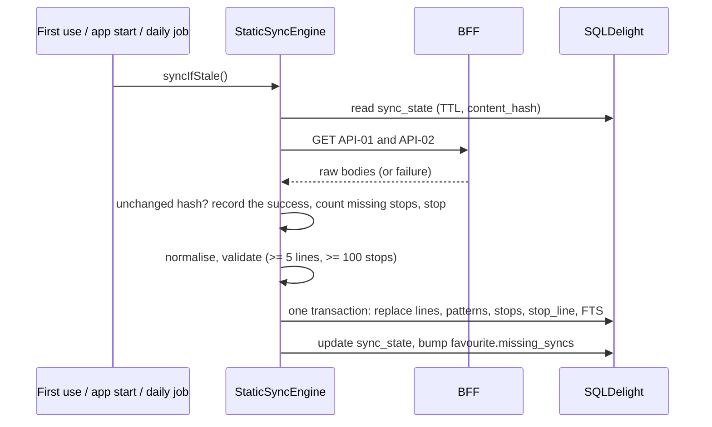
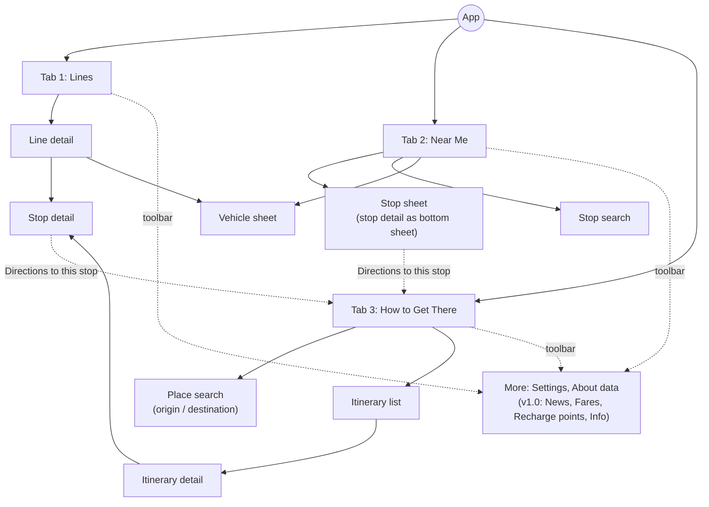

# Architecture

| Field | Value |
| --- | --- |
| Status | Draft, pre-scaffold |
| Last updated | 2026-10-27 |
| Based on | Spec §8; ADR-0001 to ADR-0009 (notably ADR-0007 feature modules, ADR-0008 offline deferral, ADR-0009 telemetry) |

LogroBus follows clean architecture and is split into feature modules. Business logic, data access and the **presentation models** are shared through Kotlin Multiplatform. The **presentation layer** (ViewModels and UI) is platform-specific: Jetpack Compose with Material 3 Expressive on Android, and SwiftUI with Liquid Glass on iOS (ADR-0007).

## 1. Principles

1. **Clean architecture.** Dependencies point inwards (presentation → domain ← data). The domain knows nothing about frameworks, I/O or platforms.
2. **Feature isolation.** Each user-facing feature is a module, and features never depend on each other. Shared business capabilities and technical concerns live in their own modules.
3. **One source of truth for rules.** Data normalisation, ETA rules, freshness and the UI models are written once in Kotlin, so both platforms behave identically.
4. **A native presentation layer.** Each platform writes its own ViewModels and UI, idiomatic to its toolkit and design language.
5. **Cache-backed, not offline-first (MVP).** Static data is cached locally for speed and search. A guaranteed offline mode comes in v1.0 (ADR-0008).
6. **A polite client.** Poll only what is visible, at the configured cadence, and identify the app through `User-Agent`.

## 2. System context



## 3. Modules

### 3.1 Layout

```
LogroBus/
├── gradle/libs.versions.toml
├── build-logic/convention/          # logrobus.kmp.library, logrobus.android.library, logrobus.android.application; detekt and Kover conventions (ADR-0011)
├── shared/
│   ├── core/
│   │   ├── common/                  # AppClock, Logger, AppDispatchers, AppResult/AppError, AppLifecycle, geo, polyline
│   │   ├── config/                  # RemoteConfig interface + compiled defaults (backend deferred, OQ-16)
│   │   ├── telemetry/               # AnalyticsTracker, CrashReporter, AnalyticsEvent, ConsentStore, no-op impls (ADR-0009)
│   │   ├── network/                 # HttpClient factory, headers, 2xx rule, lenient Json, per-item decoding
│   │   ├── database/                # SQLDelight database (single schema) and drivers
│   │   ├── location/                # LocationProvider interface + Android / iOS implementations
│   │   ├── polling/                 # PollingEngine, Timed<T>
│   │   ├── presentation/            # shared presentation primitives: EtaDisplay, Freshness, ErrorReason, LineBadgeUi + mappers
│   │   └── testing/                 # TestAppClock, fixture loader, mockSource DSL, fakes, builders
│   ├── transit/
│   │   ├── domain/                  # entities (spec §5.1), transit repository interfaces, StaticSyncEngine, shared use cases
│   │   └── data/                    # DTOs (API-01 to 06), normaliser and mappers (DD rules), DefaultStaticSyncEngine, repositories
│   ├── favourites/
│   │   ├── domain/                  # Favourite, Place, RecentPlan; repository interfaces; use cases
│   │   └── data/                    # SQLDelight-backed repositories
│   ├── feature/
│   │   ├── lines/                   # use cases + presentation models for Lines and Line detail
│   │   ├── stops/                   # stop detail and stop search
│   │   ├── nearme/                  # Near Me map layers, "My stops", "Near you"
│   │   ├── planner/                 # planner domain, data (API-07, API-08, CartoCiudad), presentation models
│   │   └── settings/                # preferences, About data
│   └── umbrella/                    # Koin graph, iOS dependency factory, iOS framework "Shared"
├── android/
│   ├── app/                         # application, single activity, tab shell, navigation, DI start-up
│   ├── core/
│   │   ├── designsystem/            # MaterialExpressiveTheme, tokens, LineBadge, EtaText (LB-011); expressive wrappers as screens need them
│   │   ├── map/                     # MapLibre composables, layers, markers
│   │   └── navigation/              # @Serializable NavKeys, and ScrollToTopOnReselect for tab roots (LB-012)
│   └── feature/
│       ├── lines/  stops/  nearme/  planner/  settings/   # Compose screens + Android ViewModels
├── iosApp/
│   ├── project.yml                  # XcodeGen spec of the app target (composition root, TabView shell, navigation, deep links)
│   │                                # and its test targets; iosApp.xcodeproj is generated from it, never committed (ADR-0010)
│   ├── iosApp/                      # app sources and resources (Localizable.xcstrings, assets)
│   ├── iosAppTests/  iosAppUITests/ # hosted checks of the built bundle; launch and journey UI tests
│   └── Packages/LogroBusUI/         # local Swift package
│       └── Sources/
│           ├── DesignSystem/        # tokens, LineBadge, EtaText, adaptiveGlass helpers
│           ├── MapUI/               # MapLibre UIViewRepresentable, layers, annotations
│           └── FeatureLines/ FeatureStops/ FeatureNearMe/ FeaturePlanner/ FeatureSettings/   # SwiftUI views + Swift ViewModels
├── tools/architecture-tests/        # Konsist rules for module and package boundaries (JVM)
├── fixtures/
└── scripts/
```

The Gradle module paths follow the folders, for example `:shared:feature:lines`, `:android:feature:lines` and `:android:app`.

### 3.2 Dependency rules



| Module | May depend on | Must not depend on |
| --- | --- | --- |
| `:shared:core:*` | Other core modules (no cycles), stdlib, coroutines, kotlinx-datetime (ADR-0015), Ktor (network only, ADR-0012), SQLDelight (database only, ADR-0013). Platform libraries in platform source sets: AndroidX lifecycle-process and UIKit (common, for `AppLifecycle`), Google Play services Location and Core Location (location only) | Any domain, data or feature module; `:shared:core:testing` |
| `:shared:core:testing` | Core and domain modules (fakes, builders) | Data and feature modules. No production module may depend on it (test scopes only) |
| `:shared:transit:domain`, `:shared:favourites:domain` | `:shared:core:common` | Data modules, network, database, platform APIs |
| `:shared:transit:data`, `:shared:favourites:data` | Their own domain module, `:shared:core:*`, Ktor and SQLDelight | Other capabilities' domains, feature modules |
| `:shared:feature:<x>` | Domain modules, `:shared:core:*` (planner's own data package may use `:shared:core:network`) | **Other feature modules**, data modules (bound through DI) |
| `:shared:umbrella` | Everything shared | Platform code |
| `:android:core:*` | `:shared:core:*`, other `:android:core:*` modules | Domain, data and feature modules |
| `:android:feature:<x>` | `:shared:feature:<x>`, domain modules, `:shared:core:*`, `:android:core:*` | Other Android or shared feature modules, data modules |
| `:android:app` | Everything Android, `:shared:umbrella` | none |
| iOS `DesignSystem` | `Shared` (XCFramework), for `EtaUi` and the shared contrast rule (LB-011) | `MapUI`, `Feature*` targets |
| iOS `Feature<X>` | `Shared` (XCFramework), `DesignSystem`, `MapUI` | Other `Feature*` targets |

`ModuleRules` (build-logic) enforces the rules between modules: every shared module fails configuration on a forbidden dependency. Konsist tests in `:tools:architecture-tests` enforce the package layering inside shared feature modules (`domain`, `data`, `presentation`) and forbid imports across features.

## 4. Shared layers

### 4.1 Core network (`:shared:core:network`)

Done in LB-005 part 1 and the first half of part 2; the DTOs and services come with LB-003's fixtures.

- **`SourceClient`**, one per process, created in the composition root (LB-010). `get(path, kind, query)` and `post(path, body, kind)` return `AppResult<JsonElement>`. The query is a map, never part of the path; its values are percent-encoded except for commas, so a list goes out as the source was captured (`lines=1,33`).
  - **Engine:** a Ktor `HttpClient` with `expectSuccess = false`, on OkHttp on Android and on the Darwin engine (NSURLSession) on iOS, chosen by `platformEngine()`. The iOS session keeps no response cache and no cookies, which NSURLSession has by default. Tests pass a `MockEngine` to the public constructor that takes an engine.
  - **Headers:** `User-Agent: LogronoBus/<version> (<platform> <os-version>)` from `ClientIdentity`, which `clientIdentity(appVersion)` fills in for this device; `Accept: application/json`; and gzip through Ktor's `ContentEncoding` plugin. The plugin is required: OkHttp decompresses transparently only when it added `Accept-Encoding` itself.
  - **Timeouts:** 5 s to connect, and a request timeout per `RequestKind`: `Live` 10 s, `Static` 30 s. The engines' socket timeouts follow the request timeout. The Darwin engine has no connect timeout of its own, so on iOS connecting is bounded by the request timeout.
  - **Results:** a 2xx with an object or array body succeeds. Another status is `Server(status)`, and a body that is not JSON, or only a scalar, is `Data`. Any failure to send is `Network` for that call only: no connection, a timeout, a malformed `api_base_url` or a redirect loop. Only the caller's own cancellation propagates.
  - **Logging:** a failure is logged at warn level as `<METHOD> <path> failed: <error>`, never with the query, a body or an exception message (NFR-PRIV-02).
- **Server clock:** a client plugin passes the time of every response, error statuses included, to `ServerCorrectedClock.onServerDate`, the `AppClock` in `:shared:core:common`.
  - The time is the `Date` header (IMF-fixdate only) plus `Age`, so a response from a cache counts from when the origin sent it.
  - A missing or unreadable header, or a time before 2026, is ignored.
  - The clock adds to the device clock the median offset of the last 5 samples (spec §8.6), so one stray sample does not move it.
- **Lenient JSON** (`api_spec.md` §3):
  - `SourceJson` is the lenient configuration.
  - `arrayAt("result", "lines")` reads a BFF envelope.
  - `decodeEach(serializer, logger)` decodes a collection item by item, returning the items and the number dropped. A dropped item is logged by DTO name, index and error type.
  - `decodeAs(serializer)` decodes a bare object, as the transit endpoints send it.
  - A missing envelope or an undecodable object is `Data`.
- **Source values (LB-006 part 1):** `String?.trimmedOrNull()` (DD-07) and `IdParser` (DD-01, DD-02, DD-06). They live here, not in `:shared:transit:data`, because the planner's mappers in `:shared:feature:planner` read the same formats and may not depend on a data module.

### 4.2 Transit data (`:shared:transit:data`)

- **DTOs and services:** `LinesApi` (API-01, 02), `RealtimeApi` (API-03 to 06).
- **Normaliser:** the pipeline of spec §5.4, with the DD-rule map in `api_spec.md` §6. It emits domain entities and a `DataQualityReport`. For the static sync it emits the `StaticCatalogue` the sync stores, shaped like the tables, and a `fingerprint` that changes whenever the same payloads would normalise differently: a new normaliser, or new name overrides (DD-11) (LB-008).
- **Normalisation rules (as built, LB-006 part 1),** the parts that need no DTO shapes, each a pure function with its `ddNN_` tests (`api_spec.md` §6):
  - `DirectionMapper` (DD-04 words) and `EtDirectionInferrer` (spec §5.6 steps 2–5);
  - `correctNextStopTime` (DD-05), on `madridTimeZone` from `:shared:core:common` (ADR-0015);
  - `NameNormaliser` (DD-11) and `LineNameParser` (spec §5.5);
  - `ServiceArea` (spec §5.4, step 7);
  - `parseCssColor` (DD-08) sits in `:shared:core:common`, beside `onColorFor`, for the planner's colours too.
  - Part 2 adds the DTOs' mappers, the `StaticNormaliser`, DD-10's provisional stops, the direction cache and the `DataQualityReport`.
- **Repositories:** `NetworkRepository` (lines, patterns, stops, search), `ArrivalsRepository`, `VehiclesRepository`.
- **Sync status (as built, LB-010 part 2):** `SyncStatusRepositoryImpl` reads `sync_state` for `SyncStatusRepository` (`:shared:transit:domain`). It gives the last successful sync of each `StaticDataset` (spec §8.5: lines and stops in the MVP), stored under the keys `lines` and `stops`, which never change with the enum's names. The static sync (LB-008) writes `sync_state` with the same keys.

### 4.3 Persistence (`:shared:core:database`)

The schema is spec §8.8 minus the offline-only tables, plus these additions:

| Addition | Purpose | Requirement |
| --- | --- | --- |
| `stop.normalized_name` | Accent- and `ñ`-folded name for FTS | NFR-I18N-03, FR-STOP-01 |
| `favourite.missing_syncs INTEGER NOT NULL DEFAULT 0` | Consecutive syncs in which a favourite stop was absent | FR-FAV-04 |
| `plan_recent(id TEXT PK, origin TEXT, destination TEXT, created_at INTEGER)` | Last 10 planner searches | FR-PLAN-09 |

Deferred to v1.0 with the offline mode (ADR-0008): the `arrival_snapshot` table and the seed import.

Done in LB-007. The schema lives in `.sq` files by area: `Line`, `Stop`, `Content` (the v1.0 tables), `Favourite` and `Sync`.

- **Departures from spec §8.8** (confirmed by the owner on 2026-10-28):
  - `stop_fts` is declared `content='stop'`: FTS4 rejects the spaces around `=` that the spec writes.
  - Key columns are `NOT NULL`: `direction_code_cache`'s three columns and `sync_state.dataset`. SQLite keeps rows whose key is NULL apart, so a NULL line or code would cache duplicates, and a NULL direction would cache an ambiguous code as known (DD-04).
  - `plan_recent.created_at` is `NOT NULL`.
  - `favourite` is `UNIQUE(type, ref_id)`.
  - `pattern_stop(stop_id)` and `stop_line(line_id)` are indexed.
- **Types:** flag columns are `INTEGER` in SQLite and `Boolean` in Kotlin. Instant columns hold UTC epoch milliseconds and read as `kotlin.time.Instant` through one `InstantColumnAdapter`. `logroBusDatabase(driver)` wires the adapters; SQLDelight asks for a table's adapters once a query uses it.
- **Search (FR-STOP-01, NFR-I18N-03):**
  - `normalized_name` is `searchableName(name)`: the `searchWords` of the name, one space apart. `searchWords` folds case, accents, `ñ` and combining marks, and splits on anything but letters and digits (`:shared:core:common`).
  - Triggers keep the external-content FTS4 index in step with every write to `stop`, including `INSERT OR REPLACE`.
  - `searchStops(text)` queries each word as a prefix of `normalized_name`, so the text is never FTS syntax. A number also finds the stop with that id, first.
- **Drivers:** `logroBusDriver(context)` on Android and `logroBusDriver()` on iOS open `logrobus.db`. Tests use the JDBC in-memory driver on the JVM and the native in-memory driver on iOS. `Shared` is a static framework, so the Swift package links the system SQLite.

### 4.4 Static data cache and sync



- On first use, an empty cache plus a failed download means the screen shows the network error with Retry (FR-ERR-05). There is no bundled seed in the MVP.
- A failed or suspicious refresh keeps the previous cache (NFR-REL-03) and is silent (FR-ERR-04).
- `sync_state.last_success` records the last *successful* sync, which About data shows (FR-SET-03, LB-404):
  - An unchanged hash skips the replace, but the sync still succeeded: it records `last_success`, which also restarts the TTL.
  - A failed or suspicious refresh leaves `last_success` as it was. `recordSync` is `INSERT OR REPLACE` over the whole row, so it must not write a null `last_success` over an earlier success.
- Background refresh runs as a daily WorkManager job on Android and as a `BGAppRefreshTask` on iOS.
- **As built (LB-008 part 1, 2026-10-30):**
  - `StaticSyncEngine.syncIfStale()` lives in `:shared:transit:domain`. `DefaultStaticSyncEngine` in `:shared:transit:data` takes a `StaticSource` (the bodies of API-01 and API-02) and a `StaticNormaliser`, both injected until LB-005's services and LB-006's normaliser exist. Part 2 binds it in Koin as a `single`, since its mutex serialises syncs per instance, and adds the triggers.
  - **TTL:** the cache is fresh while both datasets' last success is between 0 and 24 h old by `AppClock`. A dataset that never synced, or a last success in the future, which says nothing about the cache's age, makes it stale.
  - **Content hash:** the SHA-256 (`MessageDigest` on Android, CommonCrypto on iOS) of the normaliser's `fingerprint` and the body. Spec §8.5 says "of the raw body"; `SourceClient` returns decoded JSON, so the body is that JSON encoded again, which keeps key order and is as stable as the bytes. The fingerprint makes an unchanged payload renormalise when the normaliser or the name overrides change.
  - **Unchanged payload:** not normalised and not written, but the success is recorded and the saved stops are counted (FR-FAV-04 counts daily syncs, so a stable source must still reach "No longer served").
  - **Validation:** at least 5 lines and 100 stops that are not provisional, and a stop for every pattern stop (DD-10). A rejection writes nothing, its hash included, and logs only counts.
  - **One transaction** deletes and inserts lines, patterns, pattern stops, stops and served lines (the FTS triggers follow), records `sync_state` and runs `updateMissingSyncs`. Observers hear of it once, and a failure rolls all of it back.
  - **Missing syncs:** a saved stop counts as there when the catalogue has it, a provisional stop made up from a pattern included, since buses still call there (DD-10). Its `ref_id` is the canonical decimal id (DD-01), under `FavouriteTypes.STOP`.
  - **Failures** are values: one boundary turns whatever the database or the normaliser throws into `Failure(Data)` and keeps the cache. Only the caller's cancellation propagates.
  - Lines and stops download together; hashing and normalising run on the default dispatcher, the database on io.
  - **No seed:** an architecture test fails on any database file, file named "seed", or lines or stops JSON bundled under `android/`, `iosApp/` or `shared/` (ADR-0008).

### 4.5 Live data and `PollingEngine` (`:shared:core:polling`)

```kotlin
interface PollingEngine {
    /** Emits the latest value with its fetch time while collected; de-duplicated by key. */
    fun <T> poll(key: PollKey, interval: Duration, fetch: suspend () -> AppResult<T>): Flow<Timed<T>>
}
value class PollKey(val value: String)  // "<resource>:<id>", ids only: keys are logged
data class Timed<out T>(val value: T?, val fetchedAt: Instant?, val lastError: AppError?)
```

`DefaultPollingEngine` (LB-009) is created once in the composition root with an application-wide scope, `AppLifecycle`, `AppClock` and `Logger`.

- **Sharing:** each key has a `StateFlow` of its latest value and one loop, which runs while that `StateFlow` has collectors and the app is in the foreground (`subscriptionCount` combined with `AppLifecycle.isInForeground`, then `collectLatest`). Collectors of a key share its requests, and a new collector gets the latest value at once. Each new collection sets the key's interval and `fetch`, so a remote-config change applies from the next screen that collects it.
- **Schedule:** intervals come from remote config through `pollInterval()`: vehicles every 10 s, arrivals every 20 s. The engine applies the 10 s floor again and adds ±1 s of jitter, reflecting a wait below the floor above it. The next wait starts when a fetch returns, so one key never has two requests in flight. The schedule (the last attempt on a monotonic `TimeSource`, the planned wait, the failure count) belongs to the key, so leaving and re-entering a screen waits for the next scheduled fetch.
- **Failures (FR-ERR-03):** retries wait 2, 4, 8 and 16 s, then 30 s. They are exempt from the 10 s floor, as FR-ERR-03 requires. The last good value stays available with `lastError` set. A lone success between failures waits the interval without restarting the ladder; two in a row restart it, so a flapping source is retried ever more slowly.
- **A `fetch` that throws** fails its key alone (`Data`; a `CancellationException` such as a timeout gives `Network`), is logged by type and key, and is retried. The per-key coroutines run under a child supervisor.
- **Lifecycle:** the engine pauses in the background and fetches at once on returning to the foreground, unless the last attempt is under 10 s old, which is still fresh (spec §5.7). This reconciles spec §8.6's immediate fetch with its 10 s floor. A key without collectors for 120 s forgets its value, so a returning screen shows Loading rather than an expired value. Platform ViewModels own the collection scope: Android's `viewModelScope`, iOS's `.task` cancellation.
- **For presentation:** `StateFlow` merges identical emissions, so a repeated failure emits once and `fetchedAt` does not move. Freshness (fresh, stale, expired) is computed from `fetchedAt` on a UI ticker, not per emission. A manual refresh and an in-flight flag for the Refreshing state come with LB-213.

### 4.6 Feature modules (`:shared:feature:<x>`)

Each shared feature module contains three packages:

| Package | Contents |
| --- | --- |
| `domain` | Feature use cases: verb-phrase classes or `fun interface`s. Use cases consumed from Swift are exposed as interfaces, so iOS tests can replace them |
| `data` | Feature-only data sources. Only `planner` (API-07, API-08, CartoCiudad) and `settings` have one |
| `presentation` | `XUiState`, UI models, `XEvent` / `XEffect` types and pure mappers from domain to UI model |

| Feature | Use cases (examples) | Presentation models | Endpoints |
| --- | --- | --- | --- |
| `lines` | `ObserveLines`, `SearchLines`, `ObserveFavouriteLines`, `ObserveLineDetail`, `ObserveLineVehicles`, `ObserveLineArrivals` | `LinesUiState`, `LineDetailUiState`, `LineRowUi`, `FavouriteLineCardUi` | API-01, 04, 05 |
| `stops` | `ObserveStopArrivals`, `SearchStops`, `SaveStop` | `StopDetailUiState`, `ArrivalUi`, `StopSearchUiState` | API-02, 06 |
| `nearme` | `GetNearbyStops`, `ObserveSavedStopArrivals`, `ObserveNetworkVehicles` | `NearMeUiState`, `SavedStopCardUi`, `NearbyStopRowUi`, map layer models | API-02, 03, 06, 08 |
| `planner` | `SearchPlaces`, `PlanJourney`, `ObserveRecentPlans` | `PlannerUiState`, `ItineraryCardUi`, `ItineraryDetailUiState` | API-07, 08, 06, CartoCiudad |
| `settings` | `ObserveLastSyncs` (built), `UpdatePreferences`, `ClearCache` | `SettingsUiState`, `AboutDataUiState` | none |

An example of shared presentation models:

```kotlin
sealed interface StopDetailUiState {
    data object Loading : StopDetailUiState
    data class Content(
        val header: StopHeaderUi,            // name, served line badges, headsigns (DD-16)
        val arrivals: List<ArrivalUi>,
        val freshness: Freshness,            // FRESH, STALE, EXPIRED
        val isRefreshing: Boolean,
        val lineFilter: Set<Int>,
        val groupByLine: Boolean,
    ) : StopDetailUiState
    data class Empty(val nightOnly: Boolean, val nightServiceText: String?) : StopDetailUiState
    data class Error(val reason: ErrorReason) : StopDetailUiState   // NETWORK, SERVER, DATA
}

data class ArrivalUi(
    val lineId: Int, val lineCode: String, val lineColor: Long, val onLineColor: Long,
    val headsign: String?,                   // null when the direction is unknown (DD-04)
    val eta: EtaDisplay,                     // Now, Minutes(n), ClockTime(h, m), Cancelled; spec §5.7
    val lowConfidence: Boolean, val scheduled: Boolean, val delayMinutes: Int?,
)

object StopDetailUiMapper {                  // pure: same output on both platforms
    fun content(stop: Stop, arrivals: Timed<List<Arrival>>, now: Instant, filter: Set<Int>, group: Boolean): StopDetailUiState
}
```

UI models use plain types (`Int`, `String`, `Long` ARGB colours), so they export cleanly to Swift. Each platform turns `EtaDisplay` into localised text and spoken labels with its own string resources.

**As built (LB-010 part 2):**
- `settings` has `ObserveLastSyncs`, a `fun interface` implemented by `DefaultObserveLastSyncs`. It lists every `StaticDataset` in order, with its last successful sync or `null`.
- Its presentation models are `AboutDataUiState` (`Loading`, `Content`, `Error(reason)`), `AboutDataEvent.Retry`, `LastSyncUi` and `AboutDataUiMapper.state(result)`.
- Errors: the repository catches at the database boundary and emits `AppResult.Failure`; the mapper turns a failure into `Error` with an `ErrorReason` (`NETWORK`, `SERVER`, `DATA`; `:shared:core:presentation`), the short reason of FR-ERR-05.
- Times reach the UI as `MadridDateTime` (`:shared:core:presentation`): plain fields on the Madrid wall clock, which each platform formats with its locale (ADR-0015, AGENTS.md §5.5).

### 4.7 Telemetry contracts (`:shared:core:telemetry`)

These contracts are defined in ADR-0009:
- `AnalyticsTracker` with a typed `AnalyticsEvent` catalogue (ids and enums only).
- `CrashReporter` with `recordNonFatal` and enum-based breadcrumbs.
- `ConsentStore`.

Consent-gated wrappers live in shared code. In the MVP, release builds use no-op implementations and debug builds use logging ones. Vendor implementations (likely Firebase Analytics and Crashlytics) are native per platform and injected at start-up once OQ-16 is decided.

**As built (LB-017):**
- `AnalyticsEvent` and `Breadcrumb` are sealed types whose properties are ids, counts, flags and enums nested in them (`PlanResult.Rejection`, `FavouriteAdd.Kind`, `Breadcrumb.Screen`), so they cannot clash in Swift with domain types. A Konsist rule rejects any other property type, at any depth under either root, and the SwiftLint rule `swift_telemetry_payload` stops Swift from adopting either protocol.
- `CrashReporter.recordNonFatal(error, area)` takes a `CrashArea`. The crash gate passes the error on as a `RedactedThrowable`: each error of the chain with its class name and stack frames, and no messages, which can quote a URL or a payload. On Android it adopts the original stack trace, which vendors read from the Throwable; Kotlin/Native cannot set a stack, so a Swift vendor reads `frames`.
- Implementations are called from any thread, on the caller's, and must be thread-safe and non-blocking. The gates swallow any exception a vendor throws, so telemetry never breaks the caller.
- `TelemetryConsent` holds one `ConsentDecision` per kind of telemetry (`UNDECIDED`, `GRANTED`, `DENIED`), as NFR-PRIV-03's granular toggles need. `MemoryConsentStore` starts undecided and forgets on restart; LB-409 replaces it with a persisted store.
- `ConsentGatedAnalyticsTracker` and `ConsentGatedCrashReporter` read their kind of consent on every call. Nothing is queued, so a withdrawal takes effect at once.
- `NoOp*` are objects. `Logging*` print through the `Logger` at tag `Telemetry`.
- `:shared:umbrella` binds them in `telemetryModule(debug, platform)`: one `MemoryConsentStore`, then the platform's own implementations from `PlatformTelemetry` where given, otherwise logging in debug builds and no-op in release builds, each behind its gate.
- `ModuleRules` rejects vendor analytics and crash-reporting SDKs, native or Kotlin Multiplatform wrappers, in every module but `:android:app`, and detekt forbids their imports. On iOS, an architecture test keeps them out of LogroBusUI's `Package.swift`; the app target may link one.
- The gates cover every call made through the contracts, not what a vendor SDK collects by itself. LB-409 ships the SDKs with automatic collection off and ties it to consent.

## 5. Platform presentation layers

### 5.1 Android

- `:android:app`:
  - `LogroBusApplication.onCreate` calls `initKoin(this, appVersion = BuildConfig.VERSION_NAME, debug = BuildConfig.DEBUG, uiModules = listOf(settingsUiModule))` once per process. The Android module of the graph provides the platform pieces: the logger, `ProcessAppLifecycle`, the Fused location provider, the client identity and the SQLite driver. `initKoin` also takes a `PlatformTelemetry`, where LB-409 will pass the vendor's tracker and reporter (§4.7); until then the default leaves the build's telemetry. Robolectric tests run on `TestLogroBusApplication`, which stops the graph after each test.
  - A single activity draws edge-to-edge. `NavigationSuiteScaffold` holds the three tabs, and each tab keeps a Navigation 3 back stack of `@Serializable` `NavKey`s defined in `:android:core:navigation` (ADR-0005).
  - **As built (LB-012):**
    - `AppShell` chooses the `NavigationSuiteType` by width alone, as FR-NAV-05 says: a short navigation bar on compact widths, and a collapsed wide rail from the medium width up. Material's recommended type would keep a bar on a short window, such as a phone in landscape.
    - In the bar, a tab label is one line that shrinks to fit its tab at large font sizes, never below its size at 100 %. In the rail, it keeps its size and wraps.
    - `TabNavigator` holds the selected tab and one `NavBackStack` per tab, all saved across recreation and process death. It selects tabs, opens keys on the selected tab, pops a re-selected tab to its root, or asks a root to scroll to its top. On back, it pops the selected tab; at the root of another tab it returns to Lines.
    - `NavDisplay` shows the Lines stack under the selected one, so back from another tab's root has its predictive animation. Every screen change cross-fades on the motion scheme's effects spring (`ScreenTransitions` in the design system). Each tab decorates its entries with its own saveable-state and ViewModel decorators, so a popped screen's ViewModel is cleared. Each content key carries the tab, because More or About data can be on two stacks at once.
    - The shell resolves every key to its screen (`entryProvider`). A tab root receives the More action as `onOpenMore`, and its tab's re-selections through `LocalScrollToTopRequests`; a root with a list calls `ScrollToTopOnReselect(listState)`.
    - Until LB-101, LB-201 and LB-301, the tab roots are placeholders: a top app bar with the More action. Every top app bar's title is a `ScreenTitle`, a heading for TalkBack.
- `:android:feature:<x>`:
  - Each screen is an `XRoute` (wiring), a stateless `XScreen(UiState, onEvent)` and an `XViewModel : androidx.lifecycle.ViewModel`.
  - The ViewModel injects shared use cases (`koinViewModel()`), collects their flows in `viewModelScope`, maps them with the shared mappers and exposes `StateFlow<XUiState>`.
  - **As built (LB-010 part 2, `AboutDataViewModel`):**
    - `state` is the use case mapped by the shared mapper, then `stateIn(viewModelScope, WhileSubscribed(5 s), Loading)`. The query therefore outlives a configuration change, and stops 5 s after the screen leaves; a test pins both.
    - `onEvent(AboutDataEvent)`: Retry bumps a counter that `flatMapLatest` turns into a new read, starting at Loading.
    - The screen draws Loading as the final layout with placeholders, and Error with its reason and Retry. Its states for previews and screenshots live in `AboutDataPreviewData`.
    - The route collects it with `collectAsStateWithLifecycle()`.
    - Each feature module exposes a Koin `<x>UiModule` that declares its ViewModels with `viewModelOf`, and the app passes the modules to `initKoin`.
- Maps: MapLibre Native through `maplibre-compose` in `:android:core:map`.
- Location uses the Fused Location Provider of Google Play services (`fusedLocationProvider`, in `:shared:core:location`; owner approval, 2026-10-26). Permission prompts use the Activity Result API in the UI.
- `AppLifecycle` follows `ProcessLifecycleOwner` (`ProcessAppLifecycle`, in `:shared:core:common`).
- WorkManager runs the daily static refresh.

### 5.2 iOS

- **Framework integration.**
  - `:shared:umbrella` builds the `Shared` framework, with SKIE (ADR-0004): `Flow` becomes `AsyncSequence`, sealed types become Swift enums, and `suspend` functions become `async`.
  - **As built in LB-001 (ADR-0010):** Gradle produces the XCFramework, and `scripts/ios/generate-project.sh [debug|release]` copies it into `iosApp/Packages/LogroBusUI/Frameworks/`. Release builds and archives need the `release` argument.
    - The package declares it as the `Shared` binary target. The feature targets depend on it, and a `Shared` library product lets the app target `import Shared`.
    - The app links the framework once, through the package; it does not use `embedAndSignAppleFrameworkForXcode`, which would link a second copy.
    - After a Kotlin change, rerun the script. Swift Package Manager resolves binary targets before any build phase runs, so a build phase cannot refresh the framework.
    - The fallback, feature folders inside the app target, was not needed.
  - The Xcode project is generated from `iosApp/project.yml` by XcodeGen and is never committed. The same script writes `Configuration/Version.xcconfig` from `version.properties`.
  - `SharedDependencies` (LB-001, LB-010) gives the start destination and `isReady`, whether the graph has started. It implements `UseCases`, the use cases a Swift ViewModel can ask for, from the graph. SKIE is applied (LB-010 part 1).
  - `SharedDependencies.shared.preview()` returns a new `PreviewUseCases`: the real use cases over scripted repositories.
    - By default every dataset synced at 10:30 in Madrid; `loading()` and `neverSynced()` change the script.
    - `activeCollections` counts the collections running, for cancellation tests.
- **Composition root.**
  - `LogroBusApp.init` calls `doInitKoin(appVersion:debug:telemetry:)`, a Swift global function through SKIE, with `CFBundleShortVersionString`, `#if DEBUG` and a `PlatformTelemetry`, on the main actor. The iOS module of the graph creates `NotificationAppLifecycle` and Core Location there. Swift implementations of platform contracts are passed the same way: LB-409's vendor telemetry, as Swift classes conforming to `AnalyticsTracker` and `CrashReporter` (subclasses of `NSObject`), goes in `PlatformTelemetry`, which passes `nil` until then (§4.7).
  - Swift obtains use cases from the Kotlin `SharedDependencies` factory object. Koin generics are not used from Swift.
- **Swift ViewModels:** one `@MainActor @Observable final class XViewModel` per screen, in its `Feature<X>` target. As built in LB-010 part 2:

```swift
@MainActor
@Observable
public final class AboutDataViewModel {
    public private(set) var state: any AboutDataUiState = AboutDataUiStateLoading.shared
    public private(set) var attempt = 0                  // the view's .task(id:) restarts observe() on Retry
    private let useCases: any UseCases                   // kept, so the init stays cheap

    public init(useCases: any UseCases = SharedDependencies.shared) {
        self.useCases = useCases
    }

    public func onEvent(_ event: any AboutDataEvent) {
        switch onEnum(of: event) {
        case .retry:
            state = AboutDataUiStateLoading.shared
            attempt += 1
        }
    }

    /// Called from `.task(id: viewModel.attempt) { await viewModel.observe() }`; cancelled when the screen leaves.
    public func observe() async {
        for await result in useCases.observeLastSyncs().invoke() {
            state = AboutDataUiMapper.shared.state(result: result)
        }
    }
}
```

- **Views** switch over the state with `switch onEnum(of: viewModel.state) { … }`.
- **Previews and tests:** SwiftUI previews and Swift ViewModel tests use `SharedDependencies.shared.preview()`.
  - The tests live in a `Feature<X>Tests` target of `LogroBusUI`, with Swift Testing.
  - The `iosApp` scheme runs them, so `scripts/ios/test.sh` does too, until LB-101's matrix job.
  - A cancellation test cancels `observe()`, as `.task {}` does, and waits for `activeCollections` to fall back to 0.
- **The view, as built:** Loading is the final list over sample content with `.redacted(reason: .placeholder)`, Error is a `ContentUnavailableView` with the reason and Retry, and times follow SwiftUI's environment locale.
- **The shell, as built (LB-012):**
  - `AppShell`, in the app target, is a `TabView` with one `Tab` per `TopLevelDestination` and a `NavigationStack` per tab.
  - `TabRouter` (`@MainActor @Observable`) holds the selection and one `[Route]` path per tab. The `TabView`'s selection setter also runs when the selected tab is tapped again. The router then pops that tab to its root or, at the root, counts a request to scroll to the top. The shell hands the count to the root as the `scrollToTopRequests` environment value of `DesignSystem`.
    - The system pops a re-selected tab's stack by itself, after the setter, so the two agree. It does not scroll a root to its top, so the count is needed (checked on iOS 26.5 and 27.0; iOS 18 waits for LB-412).
  - The shell adds the More toolbar action to every tab root and resolves the routes: `MoreView` (app target), `SettingsView` and `AboutDataView` (`FeatureSettings`).
- **Maps:** MapLibre Native iOS (Swift package) wrapped in `MapUI`. Floating controls use the `DesignSystem` glass helpers.
- **Platform:** iPhone only in the MVP (NFR-PLAT-03), with an iOS 18 deployment target and Liquid Glass on iOS 26 or later (ADR-0003).
- **Location and lifecycle:** Core Location (`coreLocationProvider`, in `:shared:core:location`), on the main thread. `AppLifecycle` follows the `UIApplication` enter-background and enter-foreground notifications (`NotificationAppLifecycle`).

## 6. Navigation



- The app shell owns navigation on both platforms. Feature modules expose entry points but never navigate into another feature directly. They emit an effect, such as `NavigateToPlanner(destination)`, which the shell resolves.
- Stop detail belongs to the `stops` feature, and appears both as the Near Me sheet and as a pushed screen (FR-NAV-07).
- The app always opens on Lines (FR-NAV-02). Deep links (v1.0, LB-603) open their target tab.
- More, and the screens it opens, are pushed onto the selected tab's stack, so each tab keeps its own (LB-012). On Android, back at the root of Near Me or How to Get There returns to Lines, and at the root of Lines it leaves the app.

## 7. Cross-cutting concerns

| Concern | Approach |
| --- | --- |
| Dependency injection | Koin (ADR-0014). `:shared:umbrella` holds the shared graph:<br>- the core, one instance of each service per process: one `ServerCorrectedClock` (also the `AppClock`), the source client, the polling engine on an application scope, and the database;<br>- one module per data and feature module in use (transit data and settings so far).<br>`startGraph` refuses a second definition of any type, and stopping the graph cancels its scope and closes the database. The app shells pass the version and the build type. Android adds each feature module's ViewModels through `initKoin(uiModules)`, and Swift gets use cases from `SharedDependencies` (LB-010) |
| Configuration | `RemoteConfig` in `:shared:core:config` with compiled defaults (NFR-REL-05). Backend deferred (OQ-16) |
| Telemetry | Contracts in `:shared:core:telemetry`; no-op or logging in the MVP; vendor later (ADR-0009) |
| Settings | Multiplatform Settings (DataStore, `NSUserDefaults`), ADR-0018 |
| Logging | The `Logger` interface (`:shared:core:common`): `ConsoleLogger` from the debug level in debug builds; errors only in release (`security_privacy.md` §4), or `NoOpLogger`. The app's build type decides, not the shared binary's (LB-010). Never logs coordinates or free text |
| Localisation | Android `values/` (es-ES, the default) and `values-en/`; iOS `Localizable.xcstrings` with Spanish as the development language |
| Security | HTTPS only, no pinning (spec §8.7), no secrets (`security_privacy.md`) |
| Visual design | `design_guidelines.md` and a neutral placeholder theme until the Figma designs arrive near the end of the MVP (LB-413) |

## 8. Testing architecture

| Level | Where | Tooling |
| --- | --- | --- |
| Unit: mappers, DD rules, ETA rules, presentation mappers | `shared/**/src/commonTest` | kotlin.test, `TestAppClock` |
| Contract: DTO decoding | `shared/transit/data`, `shared/feature/planner` commonTest | `fixtures/` |
| Integration: repositories, sync, polling | `shared/transit/data`, `shared/favourites/data` commonTest | Ktor `MockEngine`, in-memory SQLDelight, Turbine |
| Architecture rules | `tools/architecture-tests` | Konsist |
| Android ViewModels | `android/feature/*/src/test` | JUnit, Turbine, fakes from `:shared:core:testing` |
| Android UI | `android/feature/*/src/test`, `androidTest` | Compose UI test, Roborazzi |
| iOS ViewModels and UI | `Packages/LogroBusUI/Tests`, `iosAppTests` (built-bundle checks), `iosAppUITests` | Swift Testing, swift-snapshot-testing, XCUITest |
| End to end | `maestro/` | Maestro |

The critical end-to-end journeys for the MVP (spec §10.1, adapted):

1. Cold start, open Near Me, and see live ETAs for a saved stop.
2. Search "Ayuntamiento" in Near Me, tell the two stops apart by headsign, and open arrivals.
3. Open line 10 in Lines, switch direction, and tap a live bus.
4. In How to Get There, plan a trip from the current location to an address and open the itinerary detail.
5. Lose connectivity on stop detail: see the network error state, restore the connection, tap Retry, and see the arrivals. The offline journey of spec §10.1 moves to v1.0.

## 9. Build and CI

- Versions live only in `gradle/libs.versions.toml`. Convention plugins under `build-logic/` configure KMP library, Android feature and Android app modules uniformly, and register the stable alias tasks used by CI (for example `ciUnitTest`).
- CI runs on GitHub Actions as atomic, path-filtered jobs on every pull request (`ci_cd.md`): the policy checks; the Kotlin tests, Android build and lint, ktlint, detekt, Kover (ADR-0011) and the dependency review; and the iOS build, tests and SwiftLint. The local gates are described in `agent_harness.md` and `testing_strategy.md`.

## 10. Evolution

- **Offline mode (v1.0, LB-607):** a seed bundle, the offline banner and arrival snapshots, added on top of the existing cache (ADR-0008).
- **Proxy:** switching is a remote-config change of `api_base_url` (spec §8.10).
- **v2 features** (accounts, TSC cards, payments) would add `:shared:account:*` capability modules and new feature modules.
