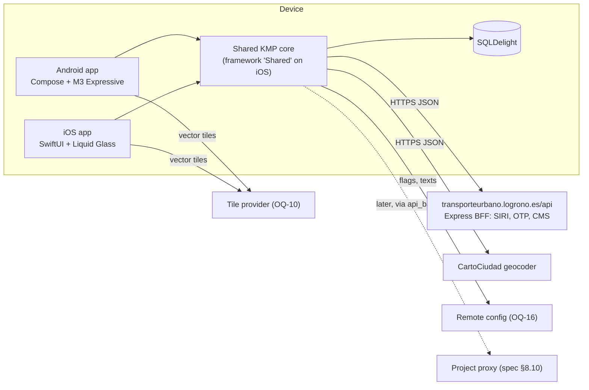
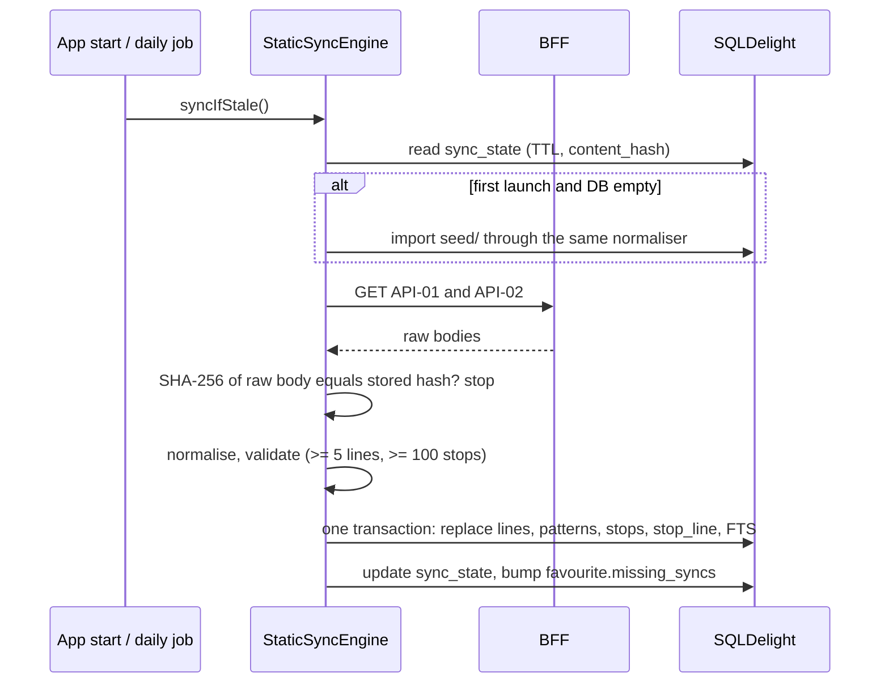
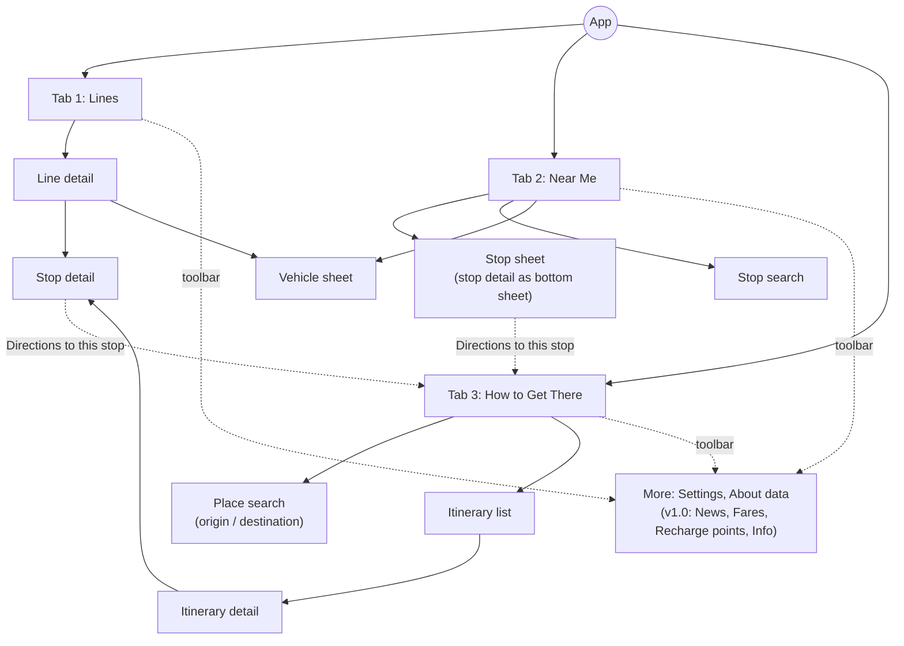

# Architecture

| Field | Value |
| --- | --- |
| Status | Draft, pre-scaffold |
| Last updated | 2026-10-22 |
| Based on | Spec §8; ADR-0001 to ADR-0005 |

LogroBus is a Kotlin Multiplatform core shared by a Jetpack Compose Android app and a SwiftUI iOS app. This document refines spec §8 with the decisions taken since then: native UI on both platforms, three-section navigation, and the Swift interop strategy. Where it departs from the spec, it cites the ADR that caused the change.

## 1. Principles

1. **Rules are written once.** Data access, normalisation, ETA logic, freshness, polling and screen state are written in Kotlin and shared.
2. **The UI is native.** Each platform renders the shared state with its own toolkit and design language: Compose with Material 3 Expressive, and SwiftUI with Liquid Glass (ADR-0001).
3. **The domain is clean.** The source API is undocumented and quirky, so every quirk is fixed at the data boundary. Nothing above `data` sees a DTO.
4. **Offline-first.** Static network data is local from the first launch. Live data degrades gracefully and always shows how fresh it is.
5. **A polite client.** The app polls only what is visible, at the configured cadence, and identifies itself through `User-Agent`.

## 2. System context



## 3. Modules

### 3.1 Repository layout

```
LogroBus/
├── gradle/libs.versions.toml
├── build-logic/convention/          # kmp-library, android-app, ktlint/detekt, kover plugins
├── shared/
│   ├── core/
│   ├── domain/
│   ├── network/
│   ├── database/
│   ├── data/
│   ├── presentation/
│   ├── testing/
│   └── umbrella/
├── androidApp/
│   └── src/main/kotlin/com/logrobus/android/
│       ├── LogroBusApplication.kt
│       ├── MainActivity.kt
│       ├── navigation/              # tabs, per-tab back stacks, deep links
│       ├── designsystem/            # theme, tokens, LineBadge, EtaText, expressive wrappers
│       ├── map/                     # MapLibre composables, layers, markers
│       ├── feature/lines/
│       ├── feature/nearme/
│       ├── feature/planner/
│       ├── feature/settings/
│       └── work/                    # WorkManager workers
├── iosApp/
│   ├── iosApp.xcodeproj
│   └── iosApp/
│       ├── LogroBusApp.swift
│       ├── Navigation/              # TabView, per-tab NavigationStack, deep links
│       ├── DesignSystem/            # tokens, LineBadge, EtaText, adaptiveGlass helpers
│       ├── Map/                     # MapLibre UIViewRepresentable, layers, annotations
│       ├── Bridge/                  # @Observable wrappers around shared ViewModels
│       ├── Features/Lines/
│       ├── Features/NearMe/
│       ├── Features/TripPlanner/
│       ├── Features/Settings/
│       └── Resources/               # Localizable.xcstrings, assets, seed files
├── fixtures/
├── seed/
└── scripts/
```

### 3.2 Responsibilities and allowed dependencies

| Module | Responsibility | May depend on |
| --- | --- | --- |
| `:shared:core` | `AppClock` (server offset), `Logger`, `AppDispatchers`, `AppResult` and `AppError`, `RemoteConfig` with compiled defaults, `AppLifecycle`, `LocationProvider` interface, geo utilities (haversine, bounding box, polyline codec) | stdlib, coroutines, kotlinx-datetime |
| `:shared:domain` | Entities (spec §5.1), repository interfaces, use cases | `core` |
| `:shared:network` | `HttpClient` factory, API services per family, DTOs, lenient decoding helpers | `core`, Ktor, kotlinx.serialization |
| `:shared:database` | SQLDelight schema, queries, driver factories (Android, Native) | `core`, SQLDelight |
| `:shared:data` | Repository implementations, mappers, normaliser, `StaticSyncEngine`, `PollingEngine`, `SeedReader`, platform `LocationProvider` implementations | `core`, `domain`, `network`, `database` |
| `:shared:presentation` | ViewModels, `UiState` types, display models (`EtaDisplay`, `Freshness`) | `core`, `domain`, lifecycle-viewmodel |
| `:shared:testing` | Fakes for every repository, `TestAppClock`, fixture loader | `core`, `domain` (test scope only) |
| `:shared:umbrella` | Assembles the Koin graph (`initKoin()`), exposes the `ViewModels` factory, and produces the iOS framework `Shared` (exports `presentation`, `domain`, `core`) | all shared modules |
| `:androidApp` | Compose UI, navigation, design system, maps, WorkManager, Glance (later) | `:shared:umbrella` |
| `iosApp` | SwiftUI UI, navigation, design system, maps, BGTasks, WidgetKit (later) | framework `Shared` |

Gradle module boundaries enforce these rules: `domain` simply cannot see Ktor or SQLDelight. iOS gets a single umbrella framework, because two separate Kotlin frameworks would each embed their own Kotlin runtime and could not share types (ADR-0004).

## 4. Layers

### 4.1 Network (`:shared:network`)

- One `HttpClient` per process. It uses the OkHttp engine on Android and Darwin on iOS, the timeouts and headers of spec §8.7, `ContentNegotiation` with the lenient `Json` from `api_spec.md` §3, and `expectSuccess = false`, so status codes are checked by hand (any 2xx succeeds).
- The `Date` header of every BFF response is fed into `AppClock` as a server-time sample.
- Services group endpoints by family: `LinesApi` (API-01, 02), `RealtimeApi` (API-03 to 06), `TransitApi` (API-07, 08), `ContentApi` (API-10 to 12) and `GeocoderApi` (CartoCiudad).
- Services return raw DTOs wrapped in `AppResult`. Collections are decoded item by item, so one malformed item never fails a whole response.

### 4.2 Data (`:shared:data`)

**Mappers and normaliser.** Every DTO goes through the pipeline of spec §5.4: lenient decode, blank-to-null and trim, id parsing, instant parsing with the DD-05 correction, direction mapping, enrichment (line code and display name, kind, contrast colour, provisional stops, name overrides), bounding-box validation, and finally the domain objects plus a `DataQualityReport`. `api_spec.md` §6 maps each `DD-nn` to the class that handles it.

**Repositories** (spec §8.4): `NetworkRepository`, `ArrivalsRepository`, `VehiclesRepository`, `PlannerRepository`, `FavouritesRepository`, `PlacesRepository`, `SettingsRepository`, and later `FaresRepository`, `RechargePointsRepository` and `NewsRepository`.

### 4.3 Persistence (`:shared:database`)

The schema is spec §8.8, plus these additions needed by the requirements:

| Addition | Purpose | Requirement |
| --- | --- | --- |
| `stop.normalized_name` column | Accent- and `ñ`-folded name for FTS matching | NFR-I18N-03, FR-STOP-01 |
| `favourite.missing_syncs INTEGER NOT NULL DEFAULT 0` | Count of consecutive daily syncs in which a favourite stop was absent | FR-FAV-04 |
| `plan_recent(id TEXT PK, origin TEXT, destination TEXT, created_at INTEGER)` | Last 10 planner searches (origin and destination as JSON place snapshots) | FR-PLAN-09 |
| `arrival_snapshot(stop_id INTEGER PK, payload TEXT, fetched_at INTEGER)` | Last arrivals for saved stops, shown as "expired" when offline | Spec §8.5, FR-STOP acceptance |

Favourites, places and recents live in a database file that is included in OS backups (FR-FAV-03). Static network data can live in the same file, because it is re-downloadable either way.

### 4.4 Static sync



- TTLs follow spec §8.5: 24 h for lines and stops, 7 d for fares and recharge points.
- A failed or suspicious sync leaves the previous dataset intact (NFR-REL-03) and never surfaces an error (FR-ERR-04).
- The seed files in `seed/` are produced by `scripts/update-seed.sh` from the live source and imported through the same mappers, so seed data and synced data follow one code path. Android ships them as assets and iOS as bundle resources; the expect/actual `SeedReader` reads them on each platform.
- Background sync runs as a daily WorkManager job on Android and as a `BGAppRefreshTask` on iOS.

### 4.5 Live data and `PollingEngine`

```kotlin
interface PollingEngine {
    /** Emits the latest value with its fetch time while collected; de-duplicated by key. */
    fun <T> poll(key: PollKey, interval: Duration, fetch: suspend () -> AppResult<T>): Flow<Timed<T>>
}
data class Timed<T>(val value: T?, val fetchedAt: Instant?, val lastError: AppError?)
```

- Subscriptions with the same `PollKey` (for example `ArrivalsAtStop(38, lines = [1, 33])`) share one upstream loop through `shareIn(WhileSubscribed)`.
- Intervals come from remote config: 10 s for vehicles, 20 s for arrivals and line ETAs, with a 10 s floor. A ±1 s jitter avoids synchronised bursts (spec §8.6).
- When a fetch fails, the engine retries with backoff of 2, 4 and 8 s, capped at 30 s. The last good value stays visible (FR-ERR-03).
- `AppLifecycle` pauses every loop when the app goes to the background and triggers an immediate fetch on return to the foreground. Android feeds it from `ProcessLifecycleOwner`; iOS feeds it from `scenePhase`.
- Freshness is derived in presentation from `AppClock.now() - fetchedAt`: under 45 s is fresh, 45 to 120 s is stale, and over 120 s is expired (spec §5.7).

### 4.6 Domain and use cases per section

| Section | Shared ViewModels | Use cases | Endpoints |
| --- | --- | --- | --- |
| Lines | `LinesViewModel`, `LineDetailViewModel` | `ObserveLines`, `SearchLines`, `ObserveFavouriteLines`, `ToggleFavourite`, `ReorderFavourites`, `ObserveLineDetail`, `ObserveLineVehicles`, `ObserveLineArrivals` | API-01, API-04, API-05 |
| Near Me | `NearMeViewModel`, `StopDetailViewModel`, `StopSearchViewModel` | `GetNearbyStops`, `ObserveSavedStopArrivals`, `ObserveStopArrivals`, `SearchStops`, `ObserveNetworkVehicles`, `SaveStop` | API-02, API-03, API-06, API-08 |
| How to Get There | `TripPlannerViewModel`, `PlaceSearchViewModel`, `ItineraryDetailViewModel` | `SearchPlaces` (stops + saved places + geocoder), `PlanJourney`, `ObserveRecentPlans`, `ObserveStopArrivals` (real-time overlay) | API-07, API-06, CartoCiudad |
| Secondary | `SettingsViewModel`, `AboutDataViewModel` | `ObserveSyncStatus`, `SyncStaticData`, `ClearCache`, `UpdatePreferences` | none |

The spec's `GetHomeDashboard` no longer exists, because the Home screen was dissolved by ADR-0002. Its parts became `ObserveSavedStopArrivals` and `GetNearbyStops`, which feed the Near Me sheet.

### 4.7 Presentation (`:shared:presentation`)

ViewModels extend the KMP `androidx.lifecycle.ViewModel`, expose `val state: StateFlow<XUiState>` and accept `fun onEvent(event: XEvent)`. One-off effects, such as navigating to the planner with a destination, are delivered through a `Channel`-backed `effects: Flow<XEffect>`.

```kotlin
sealed interface StopDetailUiState {
    data object Loading : StopDetailUiState
    data class Content(
        val header: StopHeaderUi,            // name, served line badges, headsigns (DD-16)
        val arrivals: List<ArrivalUi>,
        val freshness: Freshness,            // FRESH, STALE, EXPIRED
        val isRefreshing: Boolean,
        val isOffline: Boolean,
        val lineFilter: Set<Int>,
        val groupByLine: Boolean,
    ) : StopDetailUiState
    data class Empty(val nightOnly: Boolean, val nightServiceText: String?) : StopDetailUiState
    data class Error(val reason: ErrorReason) : StopDetailUiState   // NETWORK, SERVER, DATA
}

data class ArrivalUi(
    val lineId: Int, val lineCode: String, val lineColor: Long, val onLineColor: Long,
    val headsign: String?,                   // null when the direction is unknown (DD-04)
    val eta: EtaDisplay,
)

sealed interface EtaDisplay {                // spec §5.7; platforms localise these
    data object Now : EtaDisplay
    data class Minutes(val value: Int) : EtaDisplay
    data class ClockTime(val hour: Int, val minute: Int) : EtaDisplay   // Europe/Madrid
    data object Cancelled : EtaDisplay
    // Shared modifiers are carried on ArrivalUi in the real model: lowConfidence, scheduled, delayMinutes.
}
```

- UI models use plain types (`Int`, `String`, `Long` ARGB colours), so they export cleanly to Swift. Domain value classes stay internal to Kotlin.
- Every screen state must be able to express the UX states of spec §7.3.

## 5. Platform integration

### 5.1 Android

- `LogroBusApplication.onCreate()` calls `initKoin { androidContext(this) }`.
- There is a single activity, drawn edge-to-edge. `NavigationSuiteScaffold` hosts the three tabs, and each tab owns a Navigation 3 back stack of `@Serializable` `NavKey`s. Re-selecting the current tab pops to its root (ADR-0005).
- ViewModels are obtained with `koinViewModel()`, and state is collected with `collectAsStateWithLifecycle()`.
- Maps use MapLibre Native through `maplibre-compose`, with the style URL taken from remote config (`map_style_url`, OQ-10).
- Location uses the Fused Location Provider inside `:shared:data/androidMain`. Permission requests use the Activity Result API in the UI, just in time (FR-LOC-01).
- WorkManager runs the daily static sync, and later the notice checks. A Glance widget comes later (FR-WID).

### 5.2 iOS

- The Xcode project integrates the framework directly: a Run Script build phase calls `./gradlew :shared:umbrella:embedAndSignAppleFrameworkForXcode`. There is no CocoaPods. Swift packages (MapLibre, snapshot testing) come through Swift Package Manager.
- SKIE (ADR-0004) exposes `Flow` and `StateFlow` as `AsyncSequence`, sealed hierarchies as Swift enums through `onEnum(of:)`, and `suspend` functions as `async`.
- Startup: `@main struct LogroBusApp: App { init() { KoinKt.doInitKoin() } }`.
- **ViewModel bridge.** Each screen owns an `@Observable` wrapper from `Bridge/`. The wrapper obtains its ViewModel from the Kotlin `ViewModels` factory object, keeps it in a `ViewModelStore`, mirrors `state` into a Swift property, and clears the store when the wrapper is released. The sketch below shows the shape:

```swift
@MainActor @Observable
final class StopDetailModel {
    private(set) var state: StopDetailUiState = StopDetailUiStateLoading.shared
    private let viewModel: StopDetailViewModel

    init(stopId: Int32) { viewModel = ViewModels.shared.stopDetail(stopId: stopId) }

    /// Called from `.task { await model.observe() }`; cancelled automatically when the view goes away.
    func observe() async {
        for await next in viewModel.state { state = next }
    }

    func send(_ event: StopDetailEvent) { viewModel.onEvent(event: event) }
}
```

- Views switch over the state with `switch onEnum(of: model.state) { … }`.
- Maps use MapLibre Native iOS (Swift package `maplibre-gl-native-distribution`), wrapped in a `UIViewRepresentable` in `Map/`. Floating map controls are SwiftUI overlays that use the glass helpers.
- Location uses `CLLocationManager` inside `:shared:data/iosMain`. A small Swift helper triggers `requestWhenInUseAuthorization()` just in time.
- `BGAppRefreshTask` runs the static sync, and later the notice checks. WidgetKit comes later (FR-WID).
- The deployment target is iOS 18. Liquid Glass applies on iOS 26 and later, and the `adaptiveGlass` helpers fall back to materials on iOS 18–25 (ADR-0003).

## 6. Navigation



- Stop detail is a single shared screen. It appears as a sheet over the map in Near Me, and as a pushed screen from Lines and from itinerary detail.
- Deep links (spec §6.15) are re-targeted: `stop/{id}` opens Near Me with that stop's sheet, `line/{id}` opens Lines → Line detail, `plan?from&to` opens How to Get There pre-filled, and `news/{documentId}` opens More → News (v1.0).
- On first launch the app opens on Lines, and afterwards it restores the last selected tab (proposal, OQ-15).

## 7. Cross-cutting concerns

| Concern | Approach |
| --- | --- |
| Configuration | The `RemoteConfig` interface in `core` has compiled defaults (spec §8.9 plus `api_spec.md` §8). The backend is still undecided (OQ-16) and is hidden behind the interface |
| Settings | Multiplatform Settings (DataStore on Android, `NSUserDefaults` on iOS) for language, theme, ETA format and consents |
| Logging | The `Logger` interface has a no-op release implementation and a console debug one. Never log coordinates or free text (NFR-PRIV-02) |
| Analytics and crashes | Firebase Crashlytics and Analytics behind consent (NFR-PRIV-03), with only the events in NFR-OBS-03. The `DataQualityReport` counters are sent as aggregate numbers |
| Images | Coil 3 with a 100 MB disk cache (CMS media sends `max-age=0`, spec §4.12). Needed only from v1.0 |
| Localisation | Android: `values/strings.xml` holds es-ES as the default and `values-en/` holds English. iOS: `Localizable.xcstrings` with Spanish as the development language. Plurals come from platform resources (NFR-I18N-01) |
| Security | HTTPS only, no certificate pinning (spec §8.7), the CMS HTML allow-list sanitiser in shared code (NFR-SEC-02), and no secrets in the binary |

## 8. Testing architecture

| Level | Where | Tooling |
| --- | --- | --- |
| Unit: mappers, DD rules, ETA rules, direction inference | `shared/*/src/commonTest` | kotlin.test, `TestAppClock` |
| Contract: DTO decoding of golden payloads | `shared/network/src/commonTest` | `fixtures/` loaded through Okio from a path injected by Gradle |
| Integration: repositories, sync atomicity, offline fallback | `shared/data/src/commonTest` | Ktor `MockEngine`, in-memory SQLDelight driver, Turbine |
| ViewModels | `shared/presentation/src/commonTest` | Fakes from `:shared:testing`, Turbine, `runTest` |
| Android UI | `androidApp/src/test`, `androidTest` | Compose UI tests, Roborazzi (light, dark, 200 % font) |
| iOS UI | `iosApp/iosAppTests` | Swift Testing, swift-snapshot-testing |
| End to end | `maestro/` | Maestro flows for the critical journeys, nightly and non-blocking |
| Coverage | `data`, `domain` | Kover, with an 80 % line-coverage gate (NFR-MNT-01) |

The critical end-to-end journeys are spec §10.1, adapted to the three tabs:

1. Cold start, open Near Me, and see live ETAs for a saved stop.
2. Search "Ayuntamiento" in Near Me, tell the two stops apart by headsign, and open arrivals.
3. Open line 10 in Lines, switch direction, and tap a live bus.
4. In How to Get There, plan a trip from the current location to an address and open the itinerary detail.
5. Go offline, browse lines and stops, and see the offline banner.

## 9. Build and CI

- Versions live only in `gradle/libs.versions.toml`. Shared build logic lives in convention plugins under `build-logic/`.
- Static analysis: ktlint and detekt for Kotlin, SwiftLint for Swift (NFR-MNT-02), plus dependency scanning (NFR-SEC-05).
- CI (proposed: GitHub Actions):
  - A Linux job runs `./gradlew check :androidApp:assembleDebug`.
  - A macOS job builds the framework, runs the Xcode build and tests, and runs SwiftLint.
  - A weekly scheduled job re-records the fixtures and fails on schema diffs (spec §10.1).
  - A nightly job runs the Maestro flows.

## 10. Evolution

- **Proxy:** switching to a project-owned proxy is a remote-config change of `api_base_url`, with no release needed (spec §8.10).
- **Compose Multiplatform for iOS** is not planned (ADR-0001). Shared ViewModels keep that door open.
- **v2 features** (accounts, TSC cards, payments) would add a `:shared:auth` module and new repositories. Nothing in v1 may depend on them.
