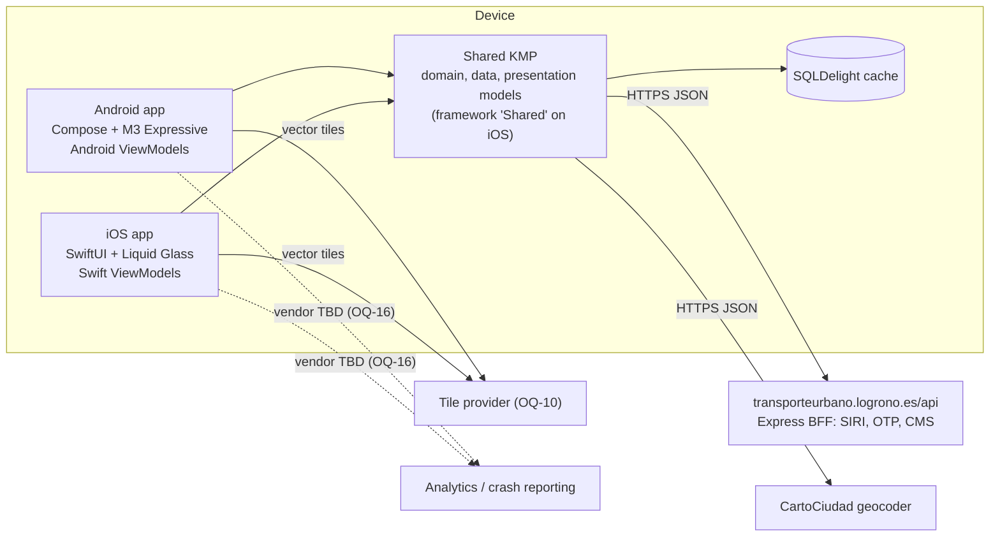
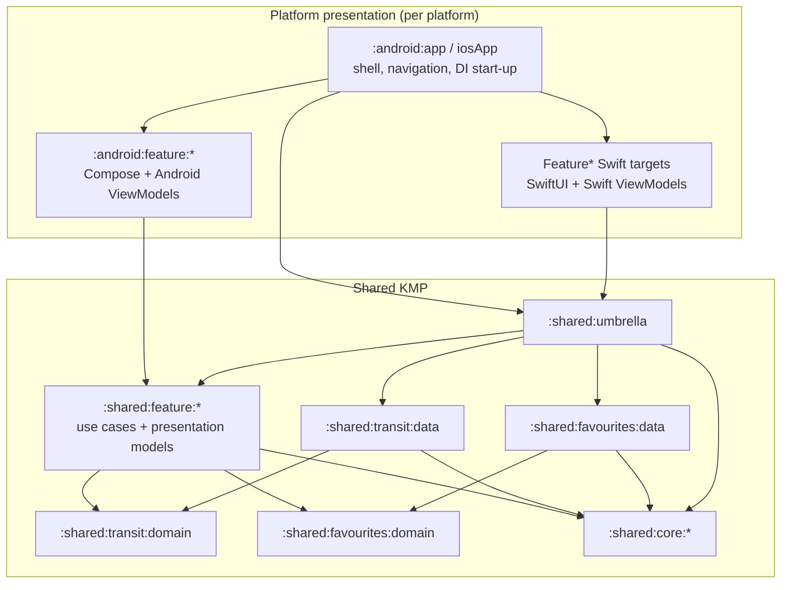
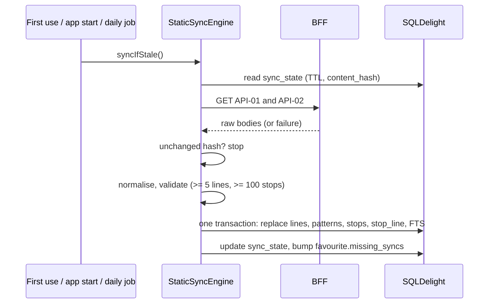
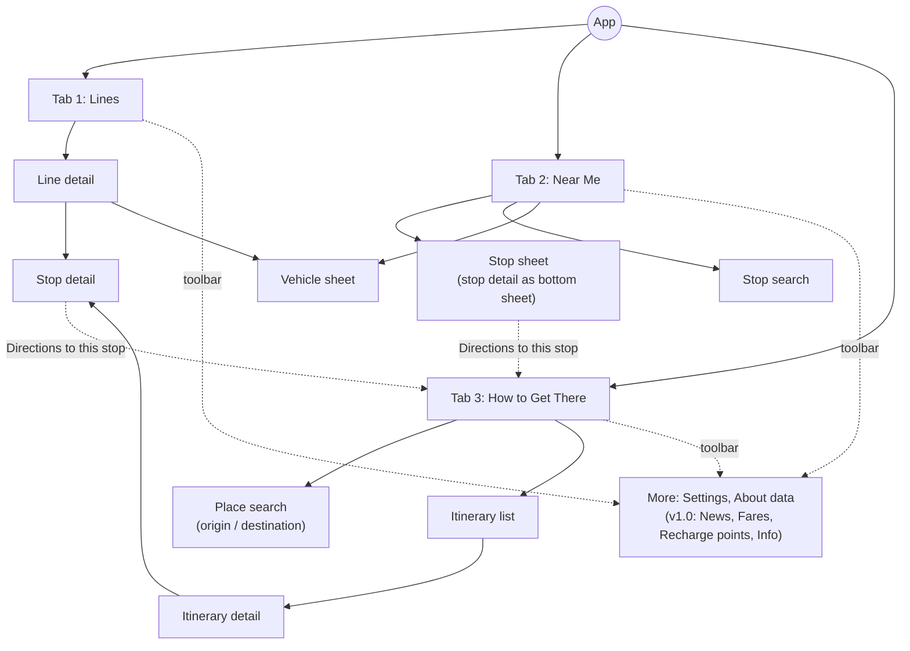

# Architecture

| Field | Value |
| --- | --- |
| Status | Draft, pre-scaffold |
| Last updated | 2026-10-22 |
| Based on | Spec §8; ADR-0001 to ADR-0009 (notably ADR-0007 feature modules, ADR-0008 offline deferral, ADR-0009 telemetry) |

LogroBus follows clean architecture and is split into feature modules. Business logic, data access and the **presentation models** are shared through Kotlin Multiplatform. The **presentation layer** (ViewModels and UI) is platform-specific: Jetpack Compose with Material 3 Expressive on Android, and SwiftUI with Liquid Glass on iOS (ADR-0007).

## 1. Principles

1. **Clean architecture.** Dependencies point inwards (presentation → domain ← data). The domain knows nothing about frameworks, I/O or platforms.
2. **Feature isolation.** Each user-facing feature is a module, and features never depend on each other. Shared business capabilities and technical concerns live in their own modules.
3. **One source of truth for rules.** Data normalisation, ETA rules, freshness and the UI models are written once in Kotlin, so both platforms behave identically.
4. **A native presentation layer.** Each platform writes its own ViewModels and UI, idiomatic to its toolkit and design language.
5. **Cache-backed, not offline-first (MVP).** Static data is cached locally for speed and search. A guaranteed offline mode comes in v1.0 (ADR-0008).
6. **A polite client.** Poll only what is visible, at the configured cadence, and identify the app through `User-Agent`.

## 2. System context



## 3. Modules

### 3.1 Layout

```
LogroBus/
├── gradle/libs.versions.toml
├── build-logic/convention/          # KMP library, Android feature, Android app, lint, Kover plugins
├── shared/
│   ├── core/
│   │   ├── common/                  # AppClock, Logger, AppDispatchers, AppResult/AppError, AppLifecycle, geo, polyline
│   │   ├── config/                  # RemoteConfig interface + compiled defaults (backend deferred, OQ-16)
│   │   ├── telemetry/               # AnalyticsTracker, CrashReporter, AnalyticsEvent, ConsentStore, no-op impls (ADR-0009)
│   │   ├── network/                 # HttpClient factory, headers, 2xx rule, lenient Json, per-item decoding
│   │   ├── database/                # SQLDelight database (single schema) and drivers
│   │   ├── location/                # LocationProvider interface + Android / iOS implementations
│   │   ├── polling/                 # PollingEngine, Timed<T>
│   │   ├── presentation/            # shared presentation primitives: EtaDisplay, Freshness, ErrorReason, LineBadgeUi + mappers
│   │   └── testing/                 # TestAppClock, fixture loader, mockSource DSL, fakes, builders
│   ├── transit/
│   │   ├── domain/                  # entities (spec §5.1), transit repository interfaces, shared use cases
│   │   └── data/                    # DTOs (API-01 to 06), normaliser and mappers (DD rules), StaticSyncEngine, repositories
│   ├── favourites/
│   │   ├── domain/                  # Favourite, Place, RecentPlan; repository interfaces; use cases
│   │   └── data/                    # SQLDelight-backed repositories
│   ├── feature/
│   │   ├── lines/                   # use cases + presentation models for Lines and Line detail
│   │   ├── stops/                   # stop detail and stop search
│   │   ├── nearme/                  # Near Me map layers, "My stops", "Near you"
│   │   ├── planner/                 # planner domain, data (API-07, API-08, CartoCiudad), presentation models
│   │   └── settings/                # preferences, About data
│   └── umbrella/                    # Koin graph, iOS dependency factory, iOS framework "Shared"
├── android/
│   ├── app/                         # application, single activity, tab shell, navigation, DI start-up
│   ├── core/
│   │   ├── designsystem/            # MaterialExpressiveTheme, tokens, LineBadge, EtaText, expressive wrappers
│   │   ├── map/                     # MapLibre composables, layers, markers
│   │   └── navigation/              # NavKeys and entry-point contracts shared by features and the app
│   └── feature/
│       ├── lines/  stops/  nearme/  planner/  settings/   # Compose screens + Android ViewModels
├── iosApp/
│   ├── iosApp.xcodeproj             # app target: composition root, TabView shell, navigation, deep links
│   ├── iosApp/                      # app sources and resources (Localizable.xcstrings, assets)
│   └── Packages/LogroBusUI/         # local Swift package
│       └── Sources/
│           ├── DesignSystem/        # tokens, LineBadge, EtaText, adaptiveGlass helpers
│           ├── MapUI/               # MapLibre UIViewRepresentable, layers, annotations
│           └── FeatureLines/ FeatureStops/ FeatureNearMe/ FeaturePlanner/ FeatureSettings/   # SwiftUI views + Swift ViewModels
├── tools/architecture-tests/        # Konsist rules for module and package boundaries (JVM)
├── fixtures/
└── scripts/
```

The Gradle module paths follow the folders, for example `:shared:feature:lines`, `:android:feature:lines` and `:android:app`.

### 3.2 Dependency rules



| Module | May depend on | Must not depend on |
| --- | --- | --- |
| `:shared:core:*` | Other core modules (no cycles), stdlib, coroutines, kotlinx-datetime, Ktor (network only), SQLDelight (database only) | Any domain, data or feature module |
| `:shared:transit:domain`, `:shared:favourites:domain` | `:shared:core:common` | Data modules, network, database, platform APIs |
| `:shared:transit:data`, `:shared:favourites:data` | Their own domain module and `:shared:core:*` | Feature modules |
| `:shared:feature:<x>` | Domain modules, `:shared:core:*` (planner's own data package may use `:shared:core:network`) | **Other feature modules**, data modules (bound through DI) |
| `:shared:umbrella` | Everything shared | Platform code |
| `:android:feature:<x>` | `:shared:feature:<x>`, `:android:core:*` | Other Android feature modules |
| `:android:app` | Everything Android, `:shared:umbrella` | none |
| iOS `Feature<X>` | `Shared` (XCFramework), `DesignSystem`, `MapUI` | Other `Feature*` targets |

Gradle module boundaries enforce the rules between modules. Konsist tests in `:tools:architecture-tests` enforce the package layering inside shared feature modules (`domain`, `data`, `presentation`) and forbid imports across features.

## 4. Shared layers

### 4.1 Core network (`:shared:core:network`)

- One `HttpClient` per process. It uses the OkHttp engine on Android and Darwin on iOS, the timeouts and headers of spec §8.7, the lenient `Json` from `api_spec.md` §3, and `expectSuccess = false`, so any 2xx succeeds.
- The `Date` header of every BFF response is fed into `AppClock` as a server-time sample.
- Collections are decoded item by item, so one bad item never fails a whole response.

### 4.2 Transit data (`:shared:transit:data`)

- **DTOs and services:** `LinesApi` (API-01, 02), `RealtimeApi` (API-03 to 06).
- **Normaliser:** the pipeline of spec §5.4, with the DD-rule map in `api_spec.md` §6. It emits domain entities and a `DataQualityReport`.
- **Repositories:** `NetworkRepository` (lines, patterns, stops, search), `ArrivalsRepository`, `VehiclesRepository`.

### 4.3 Persistence (`:shared:core:database`)

The schema is spec §8.8 minus the offline-only tables, plus these additions:

| Addition | Purpose | Requirement |
| --- | --- | --- |
| `stop.normalized_name` | Accent- and `ñ`-folded name for FTS | NFR-I18N-03, FR-STOP-01 |
| `favourite.missing_syncs INTEGER NOT NULL DEFAULT 0` | Consecutive syncs in which a favourite stop was absent | FR-FAV-04 |
| `plan_recent(id TEXT PK, origin TEXT, destination TEXT, created_at INTEGER)` | Last 10 planner searches | FR-PLAN-09 |

Deferred to v1.0 with the offline mode (ADR-0008): the `arrival_snapshot` table and the seed import.

### 4.4 Static data cache and sync



- On first use, an empty cache plus a failed download means the screen shows the network error with Retry (FR-ERR-05). There is no bundled seed in the MVP.
- A failed or suspicious refresh keeps the previous cache (NFR-REL-03) and is silent (FR-ERR-04).
- Background refresh runs as a daily WorkManager job on Android and as a `BGAppRefreshTask` on iOS.

### 4.5 Live data and `PollingEngine` (`:shared:core:polling`)

```kotlin
interface PollingEngine {
    /** Emits the latest value with its fetch time while collected; de-duplicated by key. */
    fun <T> poll(key: PollKey, interval: Duration, fetch: suspend () -> AppResult<T>): Flow<Timed<T>>
}
data class Timed<T>(val value: T?, val fetchedAt: Instant?, val lastError: AppError?)
```

- Subscriptions with the same key share one upstream loop (`shareIn(WhileSubscribed)`).
- Intervals come from remote config: vehicles every 10 s, arrivals every 20 s, with a 10 s floor and ±1 s jitter.
- When a fetch fails, the engine retries with backoff of 2, 4 and 8 s, capped at 30 s. The last good value stays available (FR-ERR-03).
- The engine pauses in the background and fetches immediately on returning to the foreground. Platform ViewModels own the collection scope: Android's `viewModelScope`, iOS's `.task` cancellation.

### 4.6 Feature modules (`:shared:feature:<x>`)

Each shared feature module contains three packages:

| Package | Contents |
| --- | --- |
| `domain` | Feature use cases: verb-phrase classes or `fun interface`s. Use cases consumed from Swift are exposed as interfaces, so iOS tests can replace them |
| `data` | Feature-only data sources. Only `planner` (API-07, API-08, CartoCiudad) and `settings` have one |
| `presentation` | `XUiState`, UI models, `XEvent` / `XEffect` types and pure mappers from domain to UI model |

| Feature | Use cases (examples) | Presentation models | Endpoints |
| --- | --- | --- | --- |
| `lines` | `ObserveLines`, `SearchLines`, `ObserveFavouriteLines`, `ObserveLineDetail`, `ObserveLineVehicles`, `ObserveLineArrivals` | `LinesUiState`, `LineDetailUiState`, `LineRowUi`, `FavouriteLineCardUi` | API-01, 04, 05 |
| `stops` | `ObserveStopArrivals`, `SearchStops`, `SaveStop` | `StopDetailUiState`, `ArrivalUi`, `StopSearchUiState` | API-02, 06 |
| `nearme` | `GetNearbyStops`, `ObserveSavedStopArrivals`, `ObserveNetworkVehicles` | `NearMeUiState`, `SavedStopCardUi`, `NearbyStopRowUi`, map layer models | API-02, 03, 06, 08 |
| `planner` | `SearchPlaces`, `PlanJourney`, `ObserveRecentPlans` | `PlannerUiState`, `ItineraryCardUi`, `ItineraryDetailUiState` | API-07, 08, 06, CartoCiudad |
| `settings` | `ObserveSyncStatus`, `UpdatePreferences`, `ClearCache` | `SettingsUiState`, `AboutDataUiState` | none |

An example of shared presentation models:

```kotlin
sealed interface StopDetailUiState {
    data object Loading : StopDetailUiState
    data class Content(
        val header: StopHeaderUi,            // name, served line badges, headsigns (DD-16)
        val arrivals: List<ArrivalUi>,
        val freshness: Freshness,            // FRESH, STALE, EXPIRED
        val isRefreshing: Boolean,
        val lineFilter: Set<Int>,
        val groupByLine: Boolean,
    ) : StopDetailUiState
    data class Empty(val nightOnly: Boolean, val nightServiceText: String?) : StopDetailUiState
    data class Error(val reason: ErrorReason) : StopDetailUiState   // NETWORK, SERVER, DATA
}

data class ArrivalUi(
    val lineId: Int, val lineCode: String, val lineColor: Long, val onLineColor: Long,
    val headsign: String?,                   // null when the direction is unknown (DD-04)
    val eta: EtaDisplay,                     // Now, Minutes(n), ClockTime(h, m), Cancelled; spec §5.7
    val lowConfidence: Boolean, val scheduled: Boolean, val delayMinutes: Int?,
)

object StopDetailUiMapper {                  // pure: same output on both platforms
    fun content(stop: Stop, arrivals: Timed<List<Arrival>>, now: Instant, filter: Set<Int>, group: Boolean): StopDetailUiState
}
```

UI models use plain types (`Int`, `String`, `Long` ARGB colours), so they export cleanly to Swift. Each platform turns `EtaDisplay` into localised text and spoken labels with its own string resources.

### 4.7 Telemetry contracts (`:shared:core:telemetry`)

These contracts are defined in ADR-0009:
- `AnalyticsTracker` with a typed `AnalyticsEvent` catalogue (ids and enums only).
- `CrashReporter` with `recordNonFatal` and enum-based breadcrumbs.
- `ConsentStore`.

Consent-gated wrappers live in shared code. In the MVP, release builds use no-op implementations and debug builds use logging ones. Vendor implementations (likely Firebase Analytics and Crashlytics) are native per platform and injected at start-up once OQ-16 is decided.

## 5. Platform presentation layers

### 5.1 Android

- `:android:app`:
  - `LogroBusApplication` calls `initKoin { androidContext(this) }` and registers the platform implementations (location, telemetry).
  - A single activity draws edge-to-edge. `NavigationSuiteScaffold` holds the three tabs, and each tab keeps a Navigation 3 back stack of `@Serializable` `NavKey`s defined in `:android:core:navigation` (ADR-0005).
- `:android:feature:<x>`:
  - Each screen is an `XRoute` (wiring), a stateless `XScreen(UiState, onEvent)` and an `XViewModel : androidx.lifecycle.ViewModel`.
  - The ViewModel injects shared use cases (`koinViewModel()`), collects their flows in `viewModelScope`, maps them with the shared mappers and exposes `StateFlow<XUiState>`.
- Maps: MapLibre Native through `maplibre-compose` in `:android:core:map`.
- Location uses the Fused Location Provider (implemented in `:shared:core:location`). Permission prompts use the Activity Result API in the UI.
- WorkManager runs the daily static refresh.

### 5.2 iOS

- **Framework integration.**
  - `:shared:umbrella` builds the `Shared` framework, with SKIE (ADR-0004): `Flow` becomes `AsyncSequence`, sealed types become Swift enums, and `suspend` functions become `async`.
  - The app target links it through `embedAndSignAppleFrameworkForXcode`.
  - The local Swift package's feature targets consume it as an XCFramework `binaryTarget`, produced by Gradle (`assembleSharedXCFramework`). This set-up is validated in LB-001; the fallback is feature folders inside the app target.
- **Composition root.**
  - `LogroBusApp.init` calls `KoinKt.doInitKoin(...)` and passes the Swift implementations of the platform contracts (telemetry once chosen).
  - Swift obtains use cases from the Kotlin `SharedDependencies` factory object. Koin generics are not used from Swift.
- **Swift ViewModels:** one `@MainActor @Observable final class XViewModel` per screen, in its `Feature<X>` target:

```swift
@MainActor @Observable
final class StopDetailViewModel {
    private(set) var state: StopDetailUiState = StopDetailUiStateLoading.shared
    private let observeArrivals: ObserveStopArrivals     // shared use case (Kotlin interface)
    private let clock: AppClock

    init(stopId: Int32, deps: SharedDependencies = .shared) {
        observeArrivals = deps.observeStopArrivals()
        clock = deps.appClock()
        self.stopId = stopId
    }
    private let stopId: Int32

    /// Called from `.task { await viewModel.observe() }`; cancelled automatically when the view disappears.
    func observe() async {
        for await timed in observeArrivals.invoke(stopId: stopId) {
            state = StopDetailUiMapper.shared.content(/* stop, timed, clock.now(), filter, group */)
        }
    }
}
```

- **Views** switch over the state with `switch onEnum(of: viewModel.state) { … }`.
- **Previews and tests:** SwiftUI previews and Swift ViewModel tests use the fake dependencies exposed by `SharedDependencies.preview` (scripted repositories in Kotlin).
- **Maps:** MapLibre Native iOS (Swift package) wrapped in `MapUI`. Floating controls use the `DesignSystem` glass helpers.
- **Platform:** iPhone only in the MVP (NFR-PLAT-03), with an iOS 18 deployment target and Liquid Glass on iOS 26 or later (ADR-0003).

## 6. Navigation



- The app shell owns navigation on both platforms. Feature modules expose entry points but never navigate into another feature directly. They emit an effect, such as `NavigateToPlanner(destination)`, which the shell resolves.
- Stop detail belongs to the `stops` feature, and appears both as the Near Me sheet and as a pushed screen (FR-NAV-07).
- The app always opens on Lines (FR-NAV-02). Deep links (v1.0, LB-603) open their target tab.

## 7. Cross-cutting concerns

| Concern | Approach |
| --- | --- |
| Configuration | `RemoteConfig` in `:shared:core:config` with compiled defaults (NFR-REL-05). Backend deferred (OQ-16) |
| Telemetry | Contracts in `:shared:core:telemetry`; no-op or logging in the MVP; vendor later (ADR-0009) |
| Settings | Multiplatform Settings (DataStore, `NSUserDefaults`) |
| Logging | The `Logger` interface: no-op in release, console in debug. Never logs coordinates or free text |
| Localisation | Android `values/` (es-ES, the default) and `values-en/`; iOS `Localizable.xcstrings` with Spanish as the development language |
| Security | HTTPS only, no pinning (spec §8.7), no secrets (`security_privacy.md`) |
| Visual design | `design_guidelines.md` and a neutral placeholder theme until the Figma designs arrive near the end of the MVP (LB-413) |

## 8. Testing architecture

| Level | Where | Tooling |
| --- | --- | --- |
| Unit: mappers, DD rules, ETA rules, presentation mappers | `shared/**/src/commonTest` | kotlin.test, `TestAppClock` |
| Contract: DTO decoding | `shared/transit/data`, `shared/feature/planner` commonTest | `fixtures/` |
| Integration: repositories, sync, polling | `shared/transit/data`, `shared/favourites/data` commonTest | Ktor `MockEngine`, in-memory SQLDelight, Turbine |
| Architecture rules | `tools/architecture-tests` | Konsist |
| Android ViewModels | `android/feature/*/src/test` | JUnit, Turbine, fakes from `:shared:core:testing` |
| Android UI | `android/feature/*/src/test`, `androidTest` | Compose UI test, Roborazzi |
| iOS ViewModels and UI | `Packages/LogroBusUI/Tests`, `iosAppUITests` | Swift Testing, swift-snapshot-testing, XCUITest |
| End to end | `maestro/` | Maestro |

The critical end-to-end journeys for the MVP (spec §10.1, adapted):

1. Cold start, open Near Me, and see live ETAs for a saved stop.
2. Search "Ayuntamiento" in Near Me, tell the two stops apart by headsign, and open arrivals.
3. Open line 10 in Lines, switch direction, and tap a live bus.
4. In How to Get There, plan a trip from the current location to an address and open the itinerary detail.
5. Lose connectivity on stop detail: see the network error state, restore the connection, tap Retry, and see the arrivals. The offline journey of spec §10.1 moves to v1.0.

## 9. Build and CI

- Versions live only in `gradle/libs.versions.toml`. Convention plugins under `build-logic/` configure KMP library, Android feature and Android app modules uniformly, and register the stable alias tasks used by CI (for example `ciUnitTest`).
- CI runs on GitHub Actions as atomic, path-filtered jobs. It is inactive while the repository is private (`ci_cd.md`). The local gates are described in `agent_harness.md` and `testing_strategy.md`.

## 10. Evolution

- **Offline mode (v1.0, LB-607):** a seed bundle, the offline banner and arrival snapshots, added on top of the existing cache (ADR-0008).
- **Proxy:** switching is a remote-config change of `api_base_url` (spec §8.10).
- **v2 features** (accounts, TSC cards, payments) would add `:shared:account:*` capability modules and new feature modules.
