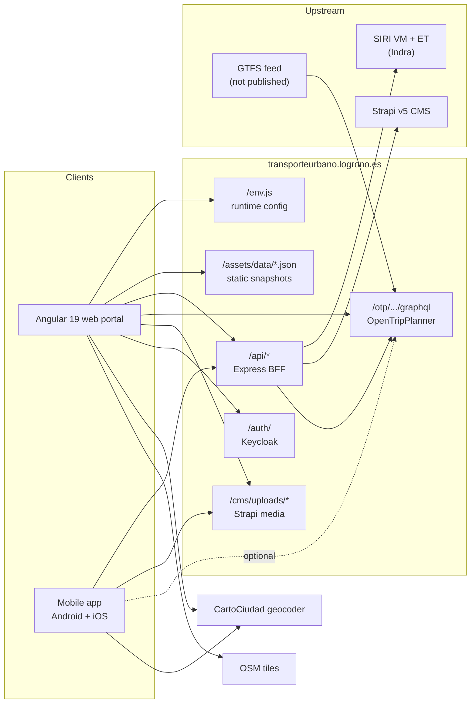
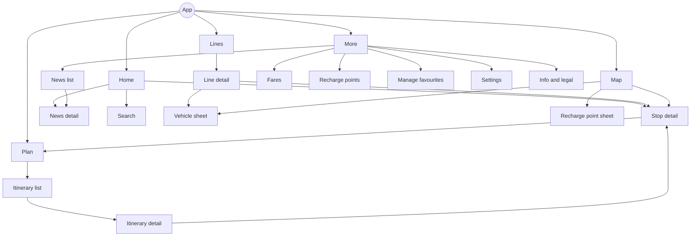
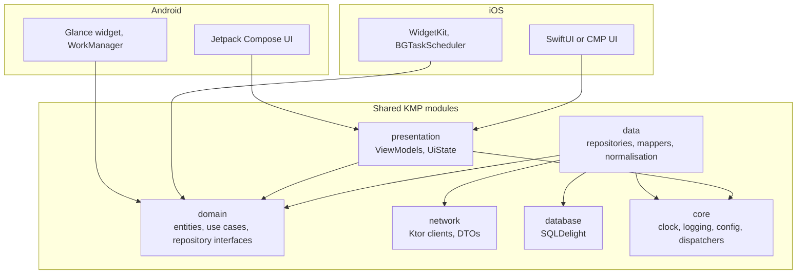

# Logroño Urban Bus App: Functional Specification

| Field | Value |
| --- | --- |
| Document | Functional specification, native Android and iOS app |
| Version | 0.1 (draft) |
| Date | 22 October 2026 |
| Author | David Ruiz Urraca |
| Source analysed | https://transporteurbano.logrono.es (live analysis, 22 Oct 2026) |
| Status | Draft for review |

This specification defines a native Android and iOS app for Logroño's urban bus network, built on the public data layer of transporteurbano.logrono.es as observed on 22 October 2026. It is precise enough to start development: every data source, field, normalisation rule and screen behaviour is stated, and every unknown is listed as an open question.

## Table of contents

1. [Document control and conventions](#1.%20Document%20control%20and%20conventions)
2. [Product overview](#2.%20Product%20overview)
3. [Source system analysis](#3.%20Source%20system%20analysis)
4. [Data sources and API contract](#4.%20Data%20sources%20and%20API%20contract)
5. [Domain model and normalisation](#5.%20Domain%20model%20and%20normalisation)
6. [Functional requirements](#6.%20Functional%20requirements)
7. [Screens, navigation and UX states](#7.%20Screens,%20navigation%20and%20UX%20states)
8. [Client architecture](#8.%20Client%20architecture)
9. [Non-functional requirements](#9.%20Non-functional%20requirements)
10. [Testing, risks, open questions and roadmap](#10.%20Testing,%20risks,%20open%20questions%20and%20roadmap)

---

## 1. Document control and conventions

### 1.1 Purpose

The document is the single source of truth for scope, data contracts and expected behaviour. It serves product, mobile engineering (Android and iOS), QA and any backend work needed to proxy or cache the source APIs.

### 1.2 Scope

In scope for v1:

- Line catalogue, line detail with map and stop sequence per direction.
- Stop catalogue, stop search, nearby stops, stop detail with real-time arrivals.
- Live vehicle positions per line and network-wide.
- Journey planning (origin to destination) via the source's planner.
- Fares catalogue, recharge points map, news and service notices.
- Favourites (lines, stops, places), home-screen widget and local notifications for service notices.

Out of scope for v1, candidates for v2 (Section 10.5):

- User accounts, TSC card management, top-ups, ticket purchase and payments (Keycloak, Redsys). These depend on an agreement with the operator and on endpoints not publicly documented.
- QR ticketing (disabled at source, `FEATURE_QR: "false"`).
- Wearable surfaces (Wear OS, watchOS).

### 1.3 Audience and assumed knowledge

Readers are assumed to know REST/JSON, GraphQL basics, Kotlin or Swift, and the SIRI and GTFS transit standards at a conceptual level.

### 1.4 Requirement keywords and identifiers

- MUST, SHOULD and MAY follow RFC 2119.
- Functional requirements are numbered `FR-<module>-<nn>` (e.g. `FR-STOP-04`).
- Non-functional requirements are numbered `NFR-<area>-<nn>`.
- Data defects observed at source are numbered `DD-<nn>` and referenced from the normalisation rules.
- Open questions are numbered `OQ-<nn>`.
- Endpoints are numbered `API-<nn>`.

### 1.5 Notation

- Endpoint paths are relative to the origin `https://transporteurbano.logrono.es` unless stated.
- Field types use Kotlin-like notation: `String`, `Int`, `Long`, `Double`, `Boolean`, `Instant`, `T?` for nullable, `List<T>`.
- All times shown to users are in `Europe/Madrid`. All times stored internally are `Instant` (UTC).
- Money is stored as `Int` minor units (euro cents).

### 1.6 Glossary

| Term | Meaning |
| --- | --- |
| BFF | Backend for frontend. The Express service under `/api/` that the official web consumes. |
| SIRI | Service Interface for Real-time Information (CEN/TS 15531). |
| SIRI VM | SIRI Vehicle Monitoring: live vehicle positions and next-stop predictions. |
| SIRI ET | SIRI Estimated Timetable: predicted arrival and departure times per stop. |
| SIRI PT | SIRI Production Timetable: planned timetable. Only seen as a static file. |
| OTP | OpenTripPlanner, the journey planner. Exposed via GraphQL. |
| GTFS | General Transit Feed Specification. OTP is loaded from a GTFS feed not otherwise published. |
| TSC | Tarjeta Sin Contacto, the operator's contactless transport card. |
| Ida / Vuelta | Outbound / return direction. Mapped to `asc` / `desc` in the lines API. |
| Búho | Night bus lines B1, B2, B3 (line ids 31, 32, 33). |
| Aimed time | Scheduled time from the timetable. |
| Expected time | Predicted time including the current delay. |
| ETA | Expected time of arrival, shown to the user as minutes or clock time. |
| Pattern | Ordered list of stops and the shape a line follows in one direction. |
| Headsign | Destination shown to riders for a pattern, i.e. its last stop. |

### 1.7 Revision history

| Version | Date | Change |
| --- | --- | --- |
| 0.1 | 22 Oct 2026 | First draft from live analysis of the source web app. |

---

## 2. Product overview

### 2.1 Vision

A fast, native, offline-tolerant app that answers "when is my bus coming and how do I get there" in under three seconds from launch, for every urban and night line in Logroño and its metropolitan stops (Lardero, Villamediana de Iregua, Varea, El Cortijo).

### 2.2 Goals

| Id | Goal | Success measure |
| --- | --- | --- |
| G1 | Real-time arrivals at a favourite stop in one tap from launch | p75 time from cold start to first ETA rendered under 3 s on a mid-range device over 4G |
| G2 | Trustworthy predictions | Every ETA shows its freshness and a confidence state; no ETA older than 60 s shown as live |
| G3 | Full network browsing offline | Lines, stops, shapes, fares and recharge points usable with no connectivity after first sync |
| G4 | Journey planning | A door-to-door plan with walking legs and bus legs for any two points in the service area |
| G5 | Native quality | Crash-free sessions above 99.8 %, accessibility compliance per Section 9 |

### 2.3 Non-goals (v1)

- Selling tickets, topping up TSC cards or managing user accounts.
- Intercity buses (La Rioja regional network) beyond what the source planner returns.
- Becoming a general-purpose map app; maps exist only to support transit tasks.

### 2.4 Personas

| Persona | Context | Primary jobs |
| --- | --- | --- |
| Daily commuter | Same 1 to 2 stops every weekday | See next arrivals at a saved stop, get notified of diversions |
| Occasional rider | Knows the destination, not the line | Plan a journey, find the nearest stop, check the fare |
| Night rider | Uses Búho lines at weekends | Check whether night service runs and when the next bus passes |
| Visitor | No local knowledge, may not read Spanish | Map-led discovery, English UI, simple fares |
| Accessibility user | Screen reader or low vision | Reliable spoken ETAs, large text, no map-only information |

### 2.5 Platforms and minimum versions

| Platform | Minimum | Target | UI toolkit |
| --- | --- | --- | --- |
| Android | API 26 (Android 8.0) | Latest stable SDK | Jetpack Compose |
| iOS | iOS 16 | Latest stable SDK | SwiftUI, or Compose Multiplatform if chosen (OQ-01) |

Shared business and data logic is implemented once with Kotlin Multiplatform (Section 8).

### 2.6 Languages

Spanish (es-ES) is the source and default language. English (en) MUST ship in v1. Line names, stop names and CMS content are shown as delivered by the source, untranslated.

---

## 3. Source system analysis

The official portal is an Angular 19.1.6 SPA backed by one Express BFF that fronts four upstream systems: a SIRI real-time service supplied by Indra, an OpenTripPlanner instance, a Strapi v5 CMS and a Keycloak identity provider. The mobile app consumes the same public surface.



### 3.1 Components

| Component | Technology | Public path | Role |
| --- | --- | --- | --- |
| Web client | Angular 19.1.6, Leaflet, Keycloak JS | `/`, `main.*.js` (2.6 MB) | Reference implementation of every feature |
| Runtime config | `window._env_` | `/env.js` | Feature flags, hosts, polling timings |
| BFF | Node.js, Express (`X-Powered-By: Express`) | `/api/*` | Aggregation, normalisation, auth proxy |
| Real-time | SIRI VM and SIRI ET, producer `Indra` | via `/api/vehicleMonitoring/*`, `/api/estimatedTimetable/*` | Live positions and predictions |
| Journey planner | OpenTripPlanner, GraphQL | `/otp/routers/default/index/graphql`, via `/api/transit/*` | Walk and transit routing |
| CMS | Strapi v5 (media `provider: local`) | via `/api/cms/*`; media at `/cms/uploads/*` | News, cards, footer pages, social links |
| Identity | Keycloak, realm `log-web-ext-realm`, client `DelegaPortalClient` | `/auth/` | Login for ticketing and card features |
| Static data | JSON files | `/assets/data/*.json` | Planned timetable snapshot, legacy recharge points |
| Geocoding | CartoCiudad (IGN), optional Nominatim and Photon | `https://www.cartociudad.es/geocoder/api/geocoder/candidates` | Address search for the planner |
| Map tiles | OpenStreetMap public tiles by default | `OSM_TILE_URL` empty = default | Base map |

### 3.2 Runtime configuration (`/env.js`)

The web client reads all environment values from `window._env_`. Values observed in production:

| Key | Value | Relevance to the app |
| --- | --- | --- |
| `API_HOST` | `https://transporteurbano.logrono.es/api/` | Base URL for every BFF call |
| `API_STRAPI` | `https://transporteurbano.logrono.es/cms` | CMS origin (media URLs are relative to it) |
| `KEYCLOAK_URL` / `KEYCLOAK_REALM` / `KEYCLOAK_CLIENT_ID` | `/auth/`, `log-web-ext-realm`, `DelegaPortalClient` | v2 only |
| `FEATURE_TICKETING`, `FEATURE_AUTH`, `FEATURE_FARES`, `FEATURE_TSC` | `"true"` | Mirror as remote config flags |
| `FEATURE_QR` | `"false"` | QR tickets disabled at source |
| `FEATURE_TSC_BLOCKING` | `""` (hidden) | Card blocking not exposed |
| `VM_POLL_INTERVAL_MS` | `10000` | Vehicle position polling period |
| `BUS_TICK_INTERVAL_MS` | `1000` | Animation tick between polls |
| `BUS_GRACE_PERIOD_MS` | `45000` | Hide a vehicle after 45 s without a report |
| `OTP_BASE_URL` | `https://transporteurbano.logrono.es` | OTP origin |
| `OSM_*` | empty | Public OSM defaults |

The app MUST NOT parse `env.js` at runtime. Equivalent values ship as defaults in the app and are overridable through the app's own remote config (Section 8.9).

### 3.3 Web client feature map

Routes found in the bundle, with v1 coverage:

| Web route | Feature | App v1 |
| --- | --- | --- |
| `/home` | Landing, news header, cards | Yes, as Home |
| `/lines` | Line list, line map, frequencies | Yes |
| `/stops` | Stop list, stop map, arrivals | Yes |
| `/routes` | Journey planner | Yes |
| `/rates` | Fares | Yes |
| `/recharge-points` | Recharge points map | Yes |
| `/news-and-notices` | News list and detail | Yes |
| `/contact-info`, `/legal-notice`, `/footer/:orden` | Static and CMS pages | Yes, as Info |
| `/cards`, `/recharge-card`, `/fees`, `/fees/tsc-validations/:travelDocId`, `/timeline`, `/trips` | TSC cards, top-up, validations history | v2 |
| `/profile`, `/payment-methods`, `/operations`, `/shopping-cart` | Account, payments, purchases | v2 |
| `/payment-success`, `/payment-error`, `/test-payment`, `/test-tokenization` | Redsys flows, test pages left in production | No |

Behaviour constants found in the web client and adopted as defaults by the app:

| Constant | Value | Meaning |
| --- | --- | --- |
| `MAX_WALK_TO_BUS_M` | 700 | Planner: max walk to the boarding stop |
| `MAX_WALK_FROM_BUS_M` | 600 | Planner: max walk from the alighting stop |
| `MAX_BUS_WAIT_MIN` | 30 | Planner: max wait at the boarding stop |
| `DIRECT_PREFERENCE_MARGIN_MIN` | 15 | Planner: prefer walking if within 15 min of the best bus option |
| Walk-distance candidates | 40 | Max stops sent to API-08 per request |
| ET preview window | 30 min | Default `previewMinutes` |
| Distance format | `< 1000 m` as `N m`, otherwise `N.N km` | Display rule |

### 3.4 Observed environment leakage

The production bundle contains fallback hosts for other environments: `logronodev.cloud.delega.co`, an ngrok tunnel, `precticlog-dev-cots-sso-ext.rec.k8s.mova.indra.es` (Keycloak) and, in `env.js` comments, `transporteurbano.saepre.logrono.es` (pre-production). The app MUST NOT reference any of them. They are useful only to request a staging environment from the operator (OQ-05).

---

## 4. Data sources and API contract

Thirteen public endpoints cover every v1 feature; none needs authentication, all answer JSON with `Access-Control-Allow-Origin: *` (OTP excepted), and none sends `Cache-Control` or rate-limit headers. The contracts below were captured live on 22 Oct 2026 and are undocumented and unversioned at source, so the client MUST parse them defensively (Section 5.4).

### 4.1 Endpoint inventory

| Id | Method and path | Purpose | Typical size | Volatility | Client refresh |
| --- | --- | --- | --- | --- | --- |
| API-01 | `GET /api/linesDiscovery/lines` | Lines, ordered stops per direction, shapes | 283 KB | Days to weeks | Daily, compare content hash |
| API-02 | `GET /api/linesDiscovery/stops` | All stops with served lines | 23 KB | Days to weeks | Daily |
| API-03 | `GET /api/vehicleMonitoring/all` | All live vehicles | 25 KB | Seconds | 10 s while network map visible |
| API-04 | `GET /api/vehicleMonitoring/byLine/{lineId}` | Live vehicles of one line | 3 KB | Seconds | 10 s while line map visible |
| API-05 | `GET /api/estimatedTimetable/byLine/{lineId}?previewMinutes={n}` | Predicted calls on a line | 35 KB (n=30) | Seconds | 20 s while line detail visible |
| API-06 | `GET /api/estimatedTimetable/byStop/{stopId}?lines={csv}&previewMinutes={n}` | Predicted arrivals at a stop | 1 KB | Seconds | 20 s while stop detail visible |
| API-07 | `POST /api/transit/route` | Door-to-door transit itineraries | 10 to 40 KB | Per request | On demand |
| API-08 | `POST /api/transit/walk-distances` | Walking distance and time to candidate stops | under 1 KB | Per request | On location change over 50 m |
| API-09 | `POST /otp/routers/default/index/graphql` | Raw OTP GraphQL (walk or bike legs) | varies | Per request | On demand, optional |
| API-10 | `GET /api/fare-products` | Fare catalogue | 15 KB | Weeks | Weekly |
| API-11 | `GET /api/tscs/recharge-points` | Card recharge points | 16 KB | Months | Weekly |
| API-12 | `GET /api/cms/news`, `/api/cms/sections`, `/api/cms/cards`, `/api/cms/pies`, `/api/cms/rrss` | News, home cards, footer pages, social links | 5 KB to 1 MB | Hours | 15 min while foreground |
| API-13 | `GET /assets/data/schedules.json` | Planned timetable snapshot (SIRI PT) | 1.46 MB | Static, stale | Not used in v1 (DD-14) |

Requests are plain HTTPS GET or POST with `Content-Type: application/json` for bodies. No API key, cookie or token is required. Successful POSTs return `201`, not `200`; the client MUST accept any `2xx`.

### 4.2 Response envelopes

| Family | Envelope | Notes |
| --- | --- | --- |
| BFF (API-01 to API-06, API-10, API-11) | `{ "result": { <collection>: [...] } }` | Collection key differs per endpoint, see below |
| BFF transit (API-07, API-08) | Bare object | `{ routes, criteria, rejection? }` and `{ items }` |
| CMS (API-12) | Strapi v5 `{ "data": [...], "meta": { "pagination": {...} } }` | |
| OTP (API-09) | GraphQL `{ "data": {...}, "errors"?: [...] }` | |

Error bodies were not observed. The client MUST treat any non-2xx, any non-JSON body, and any missing envelope key as a recoverable error for that resource (FR-ERR).

### 4.3 API-01 Lines

`GET /api/linesDiscovery/lines` returns `result.lines: List<LineDto>` (13 items).

| Field | Type | Example | Notes |
| --- | --- | --- | --- |
| `id` | `Int` | `33` | Line id. Day lines 1 to 7, 9, 10, 11; night lines 31, 32, 33 |
| `name` | `String` | `"B3-LARDERO-EL CAMPILLO"` | Format `<code>-<TERMINUS A>-<TERMINUS B>`, upper case, may contain typos (DD-11) |
| `color` | `String` | `"rgba(1,255,1,1)"` | CSS `rgba()`; API-07 returns hex for the same line (DD-08) |
| `status` | `Int` | `1` | Only `1` observed. Assumed 1 = operational (OQ-02) |
| `stops.asc` | `List<LineStopDto>` | 29 items | Outbound sequence (`Ida`) |
| `stops.desc` | `List<LineStopDto>` | 17 items | Return sequence (`Vuelta`) |

`LineStopDto`:

| Field | Type | Example | Notes |
| --- | --- | --- | --- |
| `id` | `Int` | `38` | Stop id, joins to API-02 `id` |
| `name` | `String` | `"Iglesia de Lardero"` | |
| `lat`, `lng` | `Double` | `42.426317`, `-2.461335` | WGS84 |
| `status` | `Int` | `1` | |
| `onwardShape` | `List<{lat: Double, lng: Double}>` | 8 points | Polyline from this stop to the next stop in the sequence. Empty on the last stop |

The full line shape for a direction is the concatenation of `onwardShape` in sequence order. Between 183 and 866 shape points per line (both directions).

Line catalogue as of 22 Oct 2026:

| Id | Raw name | Colour | Stops asc / desc | Outbound from, to |
| --- | --- | --- | --- | --- |
| 1 | 1-LARDERO-HOSPITAL SAN PEDRO | rgba(38,153,5,1) | 25 / 27 | Puente Madre-Hospital, Iglesia de Lardero |
| 2 | 2-YAGÜE-VAREA | rgba(255,255,0,1) | 23 / 21 | Manresa, Artesanos |
| 3 | 3-EL CAMPILLO-VILLAMEDIANA | rgba(193,0,251,1) | 32 / 32 | Casa de las Ciencias, Centro de Salud |
| 4 | 4-PALACIO DE CONGRESOS-PRADOVIEJOO | rgba(253,2,0,1) | 21 / 27 | Palacio de Congresos, Alzheimer |
| 5 | 5-MADRE DE DIOS-VALDEGASTEA | rgba(253,130,187,1) | 22 / 21 | Barrio Ballesteros, Dinamarca |
| 6 | 6-CENTRO-EL CORTIJO | rgba(146,76,72,1) | 12 / 12 | Eliseo Pinedo, Plaza de la iglesia El Cortijo |
| 7 | 7-EL ARCO-POLÍGONO CANTABRIA | rgba(186,186,186,1) | 14 / 20 | Labradores, Naval |
| 9 | 9-PRADOVIEJO-LAS NORIAS | rgba(0,2,253,1) | 19 / 20 | Las Tejeras, Las Norias |
| 10 | 10-EL ARCO-HOSPITAL SAN PEDRO | rgba(15,220,252,1) | 30 / 27 | Manuel de Falla, Artesanos |
| 11 | 11-CENTRO-HOSPITAL SAN PEDRO | rgba(255,224,125,1) | 5 / 5 | Monumento al labrador, Hospital San Pedro (recinto) |
| 31 | B1-VAREA-LA CAVA | rgba(253,2,0,1) | 23 / 23 | Artesanos, La Cava |
| 32 | B2-EL ARCO-LA ESTRELLA | rgba(0,2,253,1) | 29 / 29 | Manuel de Falla, Linares |
| 33 | B3-LARDERO-EL CAMPILLO | rgba(1,255,1,1) | 29 / 17 | Iglesia de Lardero, Casa de las Ciencias |

There is no line 8. The catalogue MUST be data-driven; this table is informative only.

### 4.4 API-02 Stops

`GET /api/linesDiscovery/stops` returns `result.stops: List<StopDto>` (254 items).

| Field | Type | Example | Notes |
| --- | --- | --- | --- |
| `id` | `Int` | `152` | Unique per physical pole; each side of a street has its own id |
| `name` | `String` | `"Plaza de la iglesia El Cortijo"` | 86 names are shared by two or more stops (opposite sides) |
| `lat`, `lng` | `Double` | `42.492503`, `-2.520566` | Bounding box lat 42.4219 to 42.4925, lng -2.5206 to -2.4050 |
| `lines` | `List<Int>` | `[6]` | Line ids serving the stop; 150 stops serve two or more lines |
| `status` | `Int` | `1` | All 254 observed as `1` |

Three stop ids referenced by API-01 do not exist in API-02: `383` and `385` ("Provisional Templarios") and `384` ("Provisional Cameros") (DD-10).

### 4.5 API-03 and API-04 Vehicle monitoring (SIRI VM)

`GET /api/vehicleMonitoring/all` and `GET /api/vehicleMonitoring/byLine/{lineId}` return `result.activities: List<VehicleActivityDto>`. About 57 vehicles network-wide at 08:20 on a weekday. The web client polls every 10 s (`VM_POLL_INTERVAL_MS`).

| Field | Type | Example | Notes |
| --- | --- | --- | --- |
| `vehicleRef` | `String` | `"9693"` | Fleet number. Not the same id space as API-05/06 `vehicleRef` (DD-03) |
| `vehicleMonitoringRef` | `String` | `"9693"` | Observed equal to `vehicleRef` |
| `lineRef` | `String` | `"1"` | Line id as string. Sometimes the literal `"[object Object]"` (DD-06) |
| `publishedLineName` | `String` | `"LARDERO-HOSPITAL SAN PEDRO"` | Origin-destination in travel order, no line code; also `"[object Object]"` when `lineRef` is |
| `directionRef` | `String` | `"Ida"` | `"Ida"`, `"Vuelta"` or `""` (DD-04) |
| `latitude`, `longitude` | `Double` | `42.470246`, `-2.436726` | WGS84 |
| `locationRecordedAtTime` | `String` ISO-8601 | `"2026-10-22T06:20:00Z"` | Correct UTC |
| `nextStopRef` | `String` | `"0632"` | Zero-padded stop id, may be `""` (DD-01) |
| `nextStopAimedArrivalTime` | `String` ISO-8601 | `"2026-10-22T08:15:55Z"` | Local wall time mislabelled as UTC (DD-05) |
| `nextStopExpectedArrivalTime` | `String` ISO-8601 | `"2026-10-22T08:19:47Z"` | Same defect as above |
| `delaySeconds` | `Int` | `245` | Positive = late. Can be negative (assumed early) |
| `confidenceLevel` | `String` | `"CERTAIN"` | Only `CERTAIN` observed. SIRI also allows `RELIABLE`, `PROBABLY_RELIABLE`, `UNCONFIRMED` |
| `monitored` | `Boolean` | `true` | |
| `predictionInaccurate` | `Boolean` | `true` | Frequently `true` |

### 4.6 API-05 and API-06 Estimated timetable (SIRI ET)

`GET /api/estimatedTimetable/byLine/{lineId}?previewMinutes={n}` and `GET /api/estimatedTimetable/byStop/{stopId}?lines={lineId,lineId}&previewMinutes={n}` return `result.arrivals: List<EstimatedCallDto>`. The web client uses `previewMinutes=30` and passes the stop's served lines (from API-02) as `lines`.

| Field | Type | Example | Notes |
| --- | --- | --- | --- |
| `lineRef` | `String` | `"1"` | Line id as string |
| `directionRef` | `String` | `"401"` | Numeric route-direction code, not `Ida`/`Vuelta` (DD-04). Line 1 uses `401`/`402`, line 2 uses `321` |
| `stopPointRef` | `String` | `"38"` | Stop id, not padded (DD-01) |
| `order` | `Int` | `25` | Position of the stop in the journey |
| `vehicleRef` | `String` | `"51"` | Internal vehicle id (DD-03) |
| `journeyCode` | `String` | `""` | Usually empty |
| `aimedArrivalTime` | `String` ISO-8601 | `"2026-10-22T08:23:32+02:00"` | Correct offset |
| `expectedArrivalTime` | `String` ISO-8601 | `"2026-10-22T08:24:54+02:00"` | Correct offset |
| `aimedDepartureTime`, `expectedDepartureTime` | `String` ISO-8601 or `""` | `""` | Empty string when unknown (DD-07) |
| `arrivalStatus`, `departureStatus` | `String` | `"NO_REPORT"` | Only `NO_REPORT` observed; may be `""` |
| `delaySeconds` | `Int` | `82` | |
| `cancellation` | `Boolean` | `false` | When `true` the call MUST be shown as cancelled |
| `predictionInaccurate` | `Boolean` | `true` | |

Ordering is not guaranteed. The client MUST sort by `expectedArrivalTime`, falling back to `aimedArrivalTime`.

### 4.7 API-07 Transit route

`POST /api/transit/route` plans door-to-door journeys. The BFF wraps OTP and applies its own feasibility rules.

Request:

```json
{
  "origin": { "lat": 42.4650, "lng": -2.4450 },
  "destination": { "lat": 42.4560, "lng": -2.4300 },
  "departureAt": "2026-10-22T06:19:00.000Z",
  "maxResults": 5
}
```

Response (`201`):

| Field | Type | Notes |
| --- | --- | --- |
| `routes` | `List<RouteDto>` | Up to `maxResults`; may be non-empty even when `rejection` is present |
| `criteria.maxWalkToBusM` | `Int` | `700` |
| `criteria.maxWalkFromBusM` | `Int` | `600` |
| `criteria.maxBusWaitMin` | `Int` | `30` |
| `criteria.directMarginMin` | `Int` | `15`. A walk-only route is preferred if it is within 15 min of the best bus route |
| `rejection.reason` | `String?` | Observed `"walk-too-far-destination"`; web also handles `"no-route"` |
| `rejection.details` | `Map<String, Number>?` | e.g. `walkDistanceM: 1328.4` |

`RouteDto`: `totalDurationSec: Int`, `totalDistanceM: Int`, `bounds: { sw: {lat,lng}, ne: {lat,lng} }`, `legs: List<LegDto>`.

`LegDto` (discriminated by `mode`):

| Field | Modes | Type | Notes |
| --- | --- | --- | --- |
| `mode` | all | `String` | `"walk"` or `"bus"` |
| `distanceM`, `durationSec` | all | `Int` | |
| `polyline` | all | `List<{lat,lng}>` | Decoded coordinates, not an encoded polyline |
| `lineId` | bus | `Int` | Joins to API-01 |
| `lineName` | bus | `String` | |
| `lineColor` | bus | `String` | Hex, e.g. `"#0FDCFC"` |
| `direction` | bus | `String` | `"asc"` or `"desc"` |
| `fromStop`, `toStop` | bus | `{ id: Int, name: String }` | Ids may exceed the API-02 range (e.g. 603, 613), OQ-03 |
| `intermediateStops` | bus | `List<{ id, name }>` | Excludes from and to |
| `departureEpochMs`, `arrivalEpochMs` | bus | `Long` | Planned (timetable) times, epoch milliseconds |

Known `rejection.reason` values and the user-facing message key each one maps to:

| Reason | Message key | Default English text |
| --- | --- | --- |
| `no-route` | `plan.error.no_route` | No bus connects these points at this time. |
| `walk-too-far-destination` | `plan.error.walk_far_destination` | The destination is more than {maxWalkFromBusM} m from any stop. |
| `walk-too-far-origin` (assumed) | `plan.error.walk_far_origin` | The origin is more than {maxWalkToBusM} m from any stop. |
| any other | `plan.error.generic` | No route could be calculated. |

### 4.8 API-08 Walk distances

`POST /api/transit/walk-distances` with `{ "origin": {lat,lng}, "destinations": [ { "id": Int, "lat": Double, "lng": Double } ] }` returns `{ "items": [ { "id": Int, "distanceM": Int, "durationSec": Int } ] }`. The web client sends at most 40 destinations, pre-filtered by straight-line distance. The app MUST follow the same cap.

### 4.9 API-09 OTP GraphQL (optional)

The web client calls OTP directly only to draw walking or cycling paths:

```graphql
{
  plan(
    from: { lat: 42.4650, lon: -2.4450 }
    to:   { lat: 42.4560, lon: -2.4300 }
    numItineraries: 1
    transportModes: [{ mode: WALK }]
  ) {
    itineraries { duration legs { distance duration legGeometry { points } } }
  }
}
```

`legGeometry.points` is a Google encoded polyline, precision 5. The schema is the standard OTP 2 GTFS GraphQL API: one feed (`feedId: "1"`, agency "La Rioja Bus", `Europe/Madrid`), routes keyed `1:<lineId>-<asc|desc>` (20 routes, one per line direction), stops keyed `1:<stopId>`. CORS is restricted to the portal origin, which does not affect native clients. v1 uses API-07 for planning and MAY use API-09 only for walking previews.

### 4.10 API-10 Fare products

`GET /api/fare-products` returns `result.cachedAt: Instant` and `result.products: List<FareProductDto>` (57 items).

| Field | Type | Example | Notes |
| --- | --- | --- | --- |
| `productCode` | `String` | `"81"` | Stable product id |
| `name` | `String` | `"Sencillo"` | |
| `description`, `literalDescription` | `String` | multi-line text | Observed identical. Contains `\n` |
| `price` | `Int` | `100` | Euro cents; `0` = free product (child, transfer, staff) |
| `maxQuantity` | `Int` | `60` | Purchase cap; `1` for monthly passes |
| `startPeriod` | `String` ISO-8601 | `"2000-01-01T00:00:00+01:00"` | Sentinel `2000-01-01` = always valid |
| `endPeriod` | `String?` | `null` | Set only for temporary products, e.g. `"Mundial Frisbee"` until 2026-07-19 |

Product names encode rider category and zone: `FN20` and `FN50` are discount tiers, `Lardero` and `Villamediana` suffixes are metropolitan variants, `QR` and `EMV` are channel variants. Section 6.7 defines how they are grouped.

### 4.11 API-11 Recharge points

`GET /api/tscs/recharge-points` returns `result.rechargePoints: List<{ id: Int, name: String, type: String, address: String, lat: Double, lng: Double }>` (121 items). `type` values include `"Estanco"`, `"Kiosco"`, `"Panaderia-Lecheria"`. The legacy static file `/assets/data/recharge-points.json` has a different id space and MUST NOT be used (DD-12).

### 4.12 API-12 CMS

All CMS calls return Strapi v5 documents with `id`, `documentId`, `createdAt`, `updatedAt`, `publishedAt`.

| Path | Query | Content fields |
| --- | --- | --- |
| `/api/cms/news` | `page` (1-based), `pageSize` (default 10) | `title`, `description` (plain summary), `text` (rich text, see DD-13), `photo: List<Media>`, `sections: List<{id, name}>`, `header: Boolean`, `order: Int`, `metadata`, `noticia` (both null) |
| `/api/cms/news?header=true&pageSize=1` | | The single featured news item for the home header |
| `/api/cms/sections` | | `name` (e.g. `"listado"`), `news: List<News>` |
| `/api/cms/cards` | | Home cards: `title`, `description`, `buttonText`, `buttonLink` (absolute URL to the web), `image: Media`, `order` |
| `/api/cms/pies` | | Footer pages: `texto` (title), `contenido` (HTML), `orden` |
| `/api/cms/rrss` | | Social links: `nombre`, `url`, `icono` (Tabler icon name, e.g. `"brand-instagram"`), `orden` |

`Media`: `url` (relative, e.g. `/uploads/x.jpg`), `width`, `height`, `mime`, `alternativeText?`, and `formats.{thumbnail,small,medium,large}` with widths 200, 500, 750 and 1000 px. Absolute media URL = `https://transporteurbano.logrono.es/cms` + `url`; the same path without `/cms` returns 404. Media is served with `Cache-Control: max-age=0`, so the app MUST cache images itself.

Pagination: `meta.pagination.{page, pageSize, pageCount, total}`. `/api/cms/news?pageSize=10` is about 1 MB because each item carries full media metadata; the app SHOULD request `pageSize=10` and prefetch the next page only on scroll.

### 4.13 API-13 Planned timetable snapshot

`/assets/data/schedules.json` is a raw SIRI PT `ProductionTimetableDelivery` used by the web to derive first departure, last departure and headway bands per line and direction. Structure: `serviceDelivery.productionTimetableDeliveries[0].datedTimetableVersionFrames[]`, each with `lineRef`, `directionRef` (`Ida`/`Vuelta`), `publishedLineNames`, and `datedVehicleJourneies[]` (sic) holding `datedCalls.datedCalls[]` with `stopPointRef`, `order` and `aimedDepartureTime`.

It is a single-day snapshot dated 18 Dec 2025, covers 18 of the 26 line-directions (no line 7, no night lines; line 1 has only 2 and 5 journeys), lists only the first stop per journey, and includes a test line name ("2-YAGÜE-VAREA PRUEBA ALEXANDER FRONT"). It is unsuitable for production use (DD-14); timetable features depend on OQ-04.

### 4.14 Endpoints outside v1 (authenticated)

For completeness, the bundle calls these under `/api/` with a Keycloak bearer token: `customers/customer`; `accounts/travel-documents`, `accounts/travel-document/{id}`, `accounts/{id}/link-tsc-card`, `accounts/{id}/unlink-tsc-card/{cardId}`, `accounts/{id}/travel-document/{docId}/block|unblock`; `botFares/products|purchase|confirm-purchase|sale-status/{id}`; `recharge/info/{id}|purchase|confirm`; `sales/{id}`, `sales/{id}/invoice`; `accounts/qr-image`, `accounts/qr-status`, `accounts/payment-method-request|payment-method-confirm`; and Redsys `/redsys`, `/tokenization`, `/payment`, `/process-return`, `/charge-with-token`. They were not called and their contracts are unknown.

---

## 5. Domain model and normalisation

The app works on a clean domain model, never on DTOs: every source quirk is fixed once in the data layer's mappers, so the UI and use cases see one id scheme, one direction scheme and correct instants.

### 5.1 Entities

```kotlin
@JvmInline value class LineId(val value: Int)
@JvmInline value class StopId(val value: Int)
@JvmInline value class VehicleId(val value: String)   // VM fleet number

enum class Direction { OUTBOUND, INBOUND }            // asc/Ida, desc/Vuelta
enum class LineKind { DAY, NIGHT }                    // NIGHT when code starts with "B"
enum class PredictionQuality { REALTIME, REALTIME_LOW_CONFIDENCE, SCHEDULED }

data class LatLng(val lat: Double, val lng: Double)

data class Line(
    val id: LineId,
    val code: String,                 // "1", "B3"
    val displayName: String,          // "Lardero - Hospital San Pedro"
    val rawName: String,              // as delivered
    val color: Rgba,                  // parsed from rgba() or hex
    val onColor: Rgba,                // black or white, WCAG contrast >= 4.5
    val kind: LineKind,
    val isOperational: Boolean,       // status == 1
    val patterns: Map<Direction, Pattern>,
)

data class Pattern(
    val direction: Direction,
    val headsign: String,             // name of the last stop
    val stops: List<PatternStop>,     // ordered
    val shape: List<LatLng>,          // concatenated onwardShape
)

data class PatternStop(val stopId: StopId, val sequence: Int, val shapeIndex: Int)

data class Stop(
    val id: StopId,
    val name: String,
    val position: LatLng,
    val lineIds: List<LineId>,
    val isOperational: Boolean,
    val isProvisional: Boolean,       // name starts with "Provisional" or not in API-02
)

data class Arrival(
    val lineId: LineId,
    val stopId: StopId,
    val direction: Direction?,        // null when unmappable
    val aimed: Instant,
    val expected: Instant?,
    val delay: Duration,
    val isCancelled: Boolean,
    val quality: PredictionQuality,
    val fetchedAt: Instant,
)

data class VehiclePosition(
    val vehicleId: VehicleId,
    val lineId: LineId?,              // null when lineRef is invalid
    val direction: Direction?,
    val position: LatLng,
    val recordedAt: Instant,
    val nextStopId: StopId?,
    val nextStopExpected: Instant?,   // corrected, see DD-05
    val delay: Duration,
    val quality: PredictionQuality,
)

data class Itinerary(val legs: List<Leg>, val duration: Duration, val distanceM: Int, val bounds: Bounds)

sealed interface Leg {
    data class Walk(val distanceM: Int, val duration: Duration, val path: List<LatLng>) : Leg
    data class Bus(
        val lineId: LineId, val direction: Direction, val from: StopRef, val to: StopRef,
        val intermediate: List<StopRef>, val plannedDeparture: Instant, val plannedArrival: Instant,
        val distanceM: Int, val duration: Duration, val path: List<LatLng>,
    ) : Leg
}

data class FareProduct(
    val code: String, val name: String, val description: String, val price: Money,
    val category: FareCategory, val tier: FareTier, val area: FareArea, val channel: FareChannel,
    val validFrom: LocalDate?, val validUntil: LocalDate?, val maxQuantity: Int,
)

data class RechargePoint(val id: Int, val name: String, val type: String, val address: String, val position: LatLng)

data class NewsItem(
    val id: Int, val documentId: String, val title: String, val summary: String,
    val bodyHtml: String, val image: ImageSet?, val isFeatured: Boolean,
    val publishedAt: Instant, val updatedAt: Instant, val affectedLineIds: Set<LineId>,
)

data class Favourite(
    val id: String,                   // UUID
    val type: FavouriteType,          // STOP, LINE, PLACE
    val refId: String,                // stop id, line id, or place UUID
    val label: String?,               // user alias
    val position: Int,                // manual sort order
    val createdAt: Instant,
)
```

### 5.2 Relationships

- A `Line` has one `Pattern` per `Direction`; a `Pattern` is an ordered list of `Stop` references plus one shape.
- A `Stop` is served by one or more lines. The API-02 `lines` list is authoritative for filtering arrivals; the pattern membership from API-01 is authoritative for drawing.
- An `Arrival` belongs to one stop and one line. `VehiclePosition` and `Arrival` cannot be joined by vehicle (DD-03); they can be joined by `(lineId, nextStopId)` only approximately.
- `NewsItem.affectedLineIds` is derived client-side by matching line references in title and summary (FR-NEWS-05).

### 5.3 Data defects found at source

| Id | Defect | Evidence | Handling rule |
| --- | --- | --- | --- |
| DD-01 | Stop ids use three formats | API-02 `152`, VM `"0632"`, ET `"38"`, OTP `"1:100"` | Parse to `Int` after stripping a `1:` prefix and leading zeros. Empty or non-numeric = `null` |
| DD-02 | Line ids use three formats | `33`, `"1"`, OTP `"1:5-desc"` | Parse to `Int`; for OTP split on `:` and `-` |
| DD-03 | Vehicle ids differ between VM and ET | VM `"9693"`, ET `"51"` for the same fleet | Never join VM and ET by vehicle. Show vehicle numbers only from VM |
| DD-04 | Direction encoded four ways | `asc`/`desc`, `Ida`/`Vuelta`, ET `"401"`/`"402"`/`"321"`, `""` | `asc`, `Ida` = OUTBOUND; `desc`, `Vuelta` = INBOUND. ET codes: infer by matching the call's `stopPointRef` and `order` against both patterns of the line; ambiguous = `null` (OQ-06) |
| DD-05 | VM next-stop times are local time labelled `Z` | `nextStopAimedArrivalTime "08:15:55Z"` while `locationRecordedAtTime "06:20:00Z"` at 08:20 local | If the parsed instant is more than 30 min after `locationRecordedAtTime`, reinterpret the wall-clock part in `Europe/Madrid`. Unit-test both CET and CEST |
| DD-06 | `lineRef` sometimes the literal `"[object Object]"` | 1 of 57 vehicles in one sample, also in `publishedLineName` | Treat as `lineId = null`; hide the vehicle from line-filtered views, show it greyed on the network map |
| DD-07 | Empty string instead of null | ET `aimedDepartureTime ""`, VM `directionRef ""`, `nextStopRef ""` | Map `""` to `null` in every string field before parsing |
| DD-08 | Line colour differs by endpoint | API-01 `rgba(15,220,252,1)`, API-07 `#0FDCFC` | Accept both. Source of truth is API-01. Two lines share red and two share blue (4 and B1, 9 and B2); always pair colour with the line code |
| DD-09 | Predictions flagged inaccurate and unreported | `predictionInaccurate: true` common, `arrivalStatus` always `NO_REPORT` | `quality = REALTIME_LOW_CONFIDENCE` when `predictionInaccurate`; show an indicator, never hide the ETA |
| DD-10 | Pattern stops missing from stop catalogue | Ids 383, 384, 385 "Provisional ..." | Create a synthetic `Stop` from the pattern entry with `isProvisional = true` |
| DD-11 | Typos and trailing spaces in names | `"PRADOVIEJOO"`, `"Provisional Templarios "` | Trim. Apply a curated override table shipped in remote config, never hard-coded |
| DD-12 | Two recharge point datasets | Static file vs API-11, different ids | Use API-11 only |
| DD-13 | News body is HTML inside a rich-text text node | `text[0].children[0].text` holds Outlook HTML with entities | Concatenate text nodes, sanitise as HTML (allow-list), render natively; strip `class` and Office attributes |
| DD-14 | Planned timetable is stale and partial | 18 Dec 2025, 18 of 26 line-directions, first stop only, test name | Do not use for user-facing schedules in v1 |
| DD-15 | POST returns `201` for reads | API-07, API-08 | Accept any `2xx` |
| DD-16 | Same stop name on both sides of the street | 86 shared names | Disambiguate in UI with the direction headsign ("towards X") and map position |
| DD-17 | `rejection` can coexist with `routes` | API-07 sample | Show routes if non-empty; show the rejection reason only when `routes` is empty |
| DD-18 | Planner stop ids outside the stop catalogue | API-07 `toStop.id 603`, `613` | Resolve by id first, then by name plus nearest coordinate on the leg polyline; if still unresolved, show the name without a stop link (OQ-03) |

### 5.4 Normalisation pipeline

Each DTO passes through the same steps in the data layer, in this order:

1. Decode JSON leniently: unknown keys ignored, missing optional keys defaulted, type mismatches logged and the item dropped (not the whole response).
2. Blank-to-null on all strings (DD-07), then trim.
3. Parse ids (DD-01, DD-02, DD-06).
4. Parse instants with offset; apply the DD-05 correction to VM next-stop fields.
5. Map directions (DD-04).
6. Enrich: line code and display name from `rawName`, `LineKind`, contrast colour, provisional stops (DD-10), name overrides (DD-11).
7. Validate: coordinates inside the service bounding box expanded by 2 km; otherwise drop the item and log.
8. Emit domain objects and a `DataQualityReport` (counts of dropped and corrected items) to analytics.

### 5.5 Line name parsing

`rawName` matches `^(?<code>B?\d{1,2})-(?<a>.+)-(?<b>.+)$` for all 13 current lines. When a terminus itself contains a hyphen the regex is ambiguous; the fallback is: `code` = text before the first hyphen, `a` and `b` = first and last stop names of the outbound pattern. `displayName` = `"<A> - <B>"` in title case with Spanish exceptions (`de`, `del`, `la`, `las`, `el`, `los`, `y` lower case), e.g. "Lardero - Hospital San Pedro".

### 5.6 Direction inference for ET calls

Because ET `directionRef` is an opaque numeric code (DD-04), the mapper resolves it as follows:

1. Look up the code in a learned cache `Map<(LineId, String), Direction>` persisted locally.
2. If absent, take all calls in the same response with that `(lineRef, directionRef)` pair. For each pattern of the line, count how many `(stopPointRef, order)` pairs match the pattern's stop at that sequence position (tolerance plus or minus 1).
3. If one pattern matches at least 80 % of the calls and the other under 50 %, assign that direction and store it in the cache.
4. For a single call at a stop served by the line in both directions, use the stop's membership: a stop present in only one pattern fixes the direction.
5. Otherwise `direction = null`, and the UI shows the arrival under the line without a headsign.

### 5.7 ETA computation and display rules

| Condition | Display | Accessibility label |
| --- | --- | --- |
| `isCancelled` | Line row struck through, label "Cancelled" | "Line 2, cancelled" |
| `expected - now < 60 s` | "Now" with pulse indicator | "Line 2, arriving now" |
| `1 min <= expected - now < 60 min` | "N min" (rounded down) | "Line 2, in N minutes" |
| `expected - now >= 60 min` | Clock time "HH:mm" | "Line 2, at HH mm" |
| `expected - now < -60 s` | Removed from the list | |
| `quality = REALTIME_LOW_CONFIDENCE` | Same value plus a "~" prefix and an info icon | "approximately" prefix |
| `quality = SCHEDULED` | Clock time in secondary colour, label "Scheduled" | "scheduled at HH mm" |
| `delay >= 120 s` | Secondary text "+N min late" | "N minutes late" |
| `delay <= -60 s` | Secondary text "N min early" | "N minutes early" |

`now` is the device clock corrected by the server offset (Section 8.6). An arrival list is "fresh" if `fetchedAt` is under 45 s old, "stale" between 45 and 120 s, and "expired" over 120 s. Stale lists show a timestamp ("Updated 1 min ago"); expired lists replace ETAs with clock times and a refresh prompt.

---

## 6. Functional requirements

Requirements are grouped by module. Each has a priority (P0 = launch blocker, P1 = launch target, P2 = post-launch) and acceptance criteria written as verifiable statements.

### 6.1 Module HOME: launch and home

| Id | Requirement | Priority |
| --- | --- | --- |
| FR-HOME-01 | The app MUST open on the Home screen showing, in this order: service notice banner (if any), favourite stops with live arrivals, nearby stops (if location permission granted), featured news. | P0 |
| FR-HOME-02 | Favourite stop cards MUST show the next 3 arrivals per stop, across all lines, sorted by expected time. | P0 |
| FR-HOME-03 | Nearby stops MUST list the 5 closest stops within 800 m, sorted by walking distance when API-08 has answered, otherwise by straight-line distance. | P0 |
| FR-HOME-04 | Home MUST refresh live data every 20 s while visible and immediately on return to foreground. | P0 |
| FR-HOME-05 | The featured news card MUST come from `/api/cms/news?header=true&pageSize=1`; it is hidden when the item is older than 14 days. | P1 |
| FR-HOME-06 | Pull-to-refresh MUST force-refresh all live data on the screen. | P0 |
| FR-HOME-07 | If no favourites exist, Home MUST show an empty state with a call to action "Find a stop" that opens Stop search. | P0 |

Acceptance criteria:

- Given two favourite stops and network available, when the app cold-starts, then ETAs for both stops are visible within 3 s at p75.
- Given location permission denied, then the nearby section is replaced by a single row "Enable location to see nearby stops" that opens the permission flow.
- Given a featured news item published 20 days ago, then no news card is shown on Home.

### 6.2 Module LINE: lines

| Id | Requirement | Priority |
| --- | --- | --- |
| FR-LINE-01 | The Lines screen MUST list all lines grouped as "Day lines" then "Night lines (Búho)", each group sorted by numeric code. | P0 |
| FR-LINE-02 | Each line row MUST show a coloured badge with the code (contrast colour per Section 5.1), the display name, and an operational status chip when `isOperational` is false. | P0 |
| FR-LINE-03 | A search field MUST filter lines by code, terminus or any stop name in either pattern, accent- and case-insensitive. | P0 |
| FR-LINE-04 | Line detail MUST show a map with both pattern shapes (selected direction emphasised), a direction toggle labelled with the headsign ("Towards Hospital San Pedro"), and the ordered stop list of the selected direction. | P0 |
| FR-LINE-05 | Each stop in the line detail list MUST show the next predicted arrival of that line at that stop, derived from API-05, or a dash when none within 30 min. | P1 |
| FR-LINE-06 | Live vehicles of the line (API-04) MUST be drawn on the map, oriented by bearing computed from the last two positions, filtered to the selected direction when the direction is known. | P0 |
| FR-LINE-07 | Vehicle markers MUST animate between polls along the pattern shape at the `BUS_TICK_INTERVAL_MS` rate and disappear after `BUS_GRACE_PERIOD_MS` without a report. | P1 |
| FR-LINE-08 | Tapping a vehicle MUST show: line, headsign, next stop name, delay, last report age. | P1 |
| FR-LINE-09 | The user MUST be able to add the line to favourites from the detail screen. | P1 |
| FR-LINE-10 | Line detail MUST link to service notices whose `affectedLineIds` contain the line. | P1 |
| FR-LINE-11 | Provisional stops (DD-10) MUST be shown with a "Provisional" tag in the stop list and a distinct map marker. | P1 |

Acceptance criteria:

- Given line 4 with typo "PRADOVIEJOO", when the override table maps it to "PRADOVIEJO", then the display name reads "Palacio de Congresos - Pradoviejo".
- Given a vehicle on line 1 with `directionRef ""`, then it is shown on the line map in both direction views with a neutral marker.
- Given no VM report for a vehicle for 46 s, then the marker is removed.

### 6.3 Module STOP: stops and arrivals

| Id | Requirement | Priority |
| --- | --- | --- |
| FR-STOP-01 | Stop search MUST match stop name and stop id, accent- and case-insensitive, returning results within 100 ms from the local database. | P0 |
| FR-STOP-02 | Search results MUST disambiguate stops sharing a name by showing the served line badges and the headsign of each pattern that visits the stop (DD-16). | P0 |
| FR-STOP-03 | Stop detail MUST show the stop name, served lines, a small map, and the real-time arrival list from API-06 with `lines` = all served lines and `previewMinutes` = 60. | P0 |
| FR-STOP-04 | The arrival list MUST follow the display rules of Section 5.7 and be grouped by line when the user selects "Group by line"; default is chronological. | P0 |
| FR-STOP-05 | The arrival list MUST auto-refresh every 20 s while visible, with a visible "Updated N s ago" indicator. | P0 |
| FR-STOP-06 | If API-06 returns an empty list, the screen MUST show "No buses in the next 60 minutes" and, for stops served only by night lines, the text "Night service runs on Friday, Saturday and holiday eves" (text from remote config, OQ-08). | P0 |
| FR-STOP-07 | The user MUST be able to filter the arrival list by line via chips. | P1 |
| FR-STOP-08 | The user MUST be able to add the stop to favourites and set an alias. | P0 |
| FR-STOP-09 | Stop detail MUST offer "Directions to this stop" (walking, opens Plan with destination set) and "Show on map". | P1 |
| FR-STOP-10 | The Stops map MUST cluster stop markers below zoom 15 and show individual markers with line badges above zoom 16. | P0 |
| FR-STOP-11 | "Near me" MUST centre the map on the user and list stops within 800 m sorted by walking distance (API-08, at most 40 candidates). | P0 |

Acceptance criteria:

- Given stop 38 served by lines 1 and 33, when stop detail opens, then API-06 is called with `lines=1,33&previewMinutes=60`.
- Given an arrival with `cancellation: true`, then it is shown struck through with the label "Cancelled" and not counted on the Home card.
- Given the device offline, then stop detail shows the last cached arrivals as "expired" clock times and an offline banner.

### 6.4 Module LIVE: network live map

| Id | Requirement | Priority |
| --- | --- | --- |
| FR-LIVE-01 | A network map MUST show all live vehicles from API-03, colour-coded by line with the line code in the marker. | P1 |
| FR-LIVE-02 | Polling of API-03 MUST run every 10 s only while the map is visible and the app is in the foreground. | P0 |
| FR-LIVE-03 | Vehicles with `lineId = null` (DD-06) MUST be shown as grey markers without a code. | P1 |
| FR-LIVE-04 | A line filter MUST allow showing a subset of lines; selection persists across sessions. | P2 |
| FR-LIVE-05 | All line shapes MUST be drawable as an optional layer ("Show all routes"). | P1 |

### 6.5 Module PLAN: journey planner

| Id | Requirement | Priority |
| --- | --- | --- |
| FR-PLAN-01 | The planner MUST accept origin and destination as: current location, favourite place, stop, map point (long press) or address search. | P0 |
| FR-PLAN-02 | Address search MUST use the CartoCiudad geocoder, restricted to La Rioja, debounced at 300 ms, minimum 3 characters, showing at most 8 suggestions. | P0 |
| FR-PLAN-03 | The user MUST be able to choose "Leave now" or "Depart at" a date and time; the value is sent as `departureAt` in UTC. | P0 |
| FR-PLAN-04 | The planner MUST call API-07 with `maxResults = 5` and present itineraries sorted by arrival time, each summarised as: total duration, departure and arrival clock times, line badges in leg order, total walking distance. | P0 |
| FR-PLAN-05 | Itinerary detail MUST show a map with walk legs dashed and bus legs in line colour, plus a step list: walk to stop, board line X towards headsign at time, ride N stops (expandable to intermediate stops), alight, walk to destination. | P0 |
| FR-PLAN-06 | For the first bus leg departing within 60 min, the detail MUST overlay the real-time ETA at the boarding stop from API-06 next to the planned time. | P1 |
| FR-PLAN-07 | When API-07 returns no routes, the screen MUST show the message mapped from `rejection.reason` (Section 4.7) and the criteria values in the text. | P0 |
| FR-PLAN-08 | Swap origin and destination MUST be one tap. | P0 |
| FR-PLAN-09 | The last 10 planned searches MUST be stored locally and offered as recents. | P1 |
| FR-PLAN-10 | Origin or destination outside the service bounding box expanded by 5 km MUST be rejected client-side with "This location is outside the service area". | P1 |

Acceptance criteria:

- Given origin 42.4650, -2.4450 and destination 42.4560, -2.4300 at 08:19, then at least one itinerary with a bus leg on line 10 or 3 is shown (matches observed source behaviour).
- Given a response with `routes: []` and `rejection.reason = "walk-too-far-destination"`, then the message reads "The destination is more than 600 m from any stop."

### 6.6 Module NEWS: news and service notices

| Id | Requirement | Priority |
| --- | --- | --- |
| FR-NEWS-01 | The News screen MUST list items from API-12 newest first by `publishedAt`, paginated by 10, with thumbnail (`formats.thumbnail`), title, summary and date. | P0 |
| FR-NEWS-02 | News detail MUST render the sanitised body (DD-13) natively with headings, bold, underline, lists and links; images use `formats.medium` or `large` by screen width. | P0 |
| FR-NEWS-03 | Links in the body MUST open in an in-app browser tab (Custom Tabs, SFSafariViewController). | P0 |
| FR-NEWS-04 | News MUST be cached for offline reading; the latest 30 items are kept. | P1 |
| FR-NEWS-05 | The app MUST derive `affectedLineIds` by matching patterns such as "línea 3", "líneas 3 y 9", "L3", "B1" (case- and accent-insensitive) in title and summary. | P1 |
| FR-NEWS-06 | A news item counts as an active service notice if it has `affectedLineIds` and was published in the last 7 days; active notices drive the Home banner and the line detail link. | P1 |
| FR-NEWS-07 | A share action MUST share the title and the canonical web URL of the news section. | P2 |

### 6.7 Module FARE: fares

| Id | Requirement | Priority |
| --- | --- | --- |
| FR-FARE-01 | The Fares screen MUST show products from API-10 grouped into categories: General, Passes (Bonobus, Bonomes), Reduced (Tarifa reducida, Jubilado, Estudiante), Free (price 0), Night (Búho), Special (anything with `endPeriod`). | P0 |
| FR-FARE-02 | Within a category, variants by tier (base, FN20, FN50) and area (Logroño, Lardero, Villamediana) MUST be presented as a compact matrix, not as separate rows. | P1 |
| FR-FARE-03 | Prices MUST be formatted from cents with the device locale ("1,00 €" in es-ES, "€1.00" in en). | P0 |
| FR-FARE-04 | Products with `endPeriod` in the past MUST be hidden; products with a future `startPeriod` MUST be shown with "From DATE". | P0 |
| FR-FARE-05 | Channel variants `QR` and `EMV` MUST be hidden while `FEATURE_QR` is false in remote config. | P1 |
| FR-FARE-06 | The meaning of FN20 and FN50 (discount tiers, assumed large-family 20 % and 50 %) MUST come from remote config text, not hard-coded (OQ-09). | P1 |

Classification rules (applied in order, first match wins):

| Rule | Field | Pattern | Result |
| --- | --- | --- | --- |
| 1 | `endPeriod` | not null | Special |
| 2 | `price` | `0` | Free |
| 3 | `name` | `^B[uú]ho` | Night |
| 4 | `name` | `^(Tarifa reducida\|Jubilado\|Estudiante)` | Reduced |
| 5 | `name` | `^(Bonobus\|Bonomes\|10 viajes)` | Passes |
| 6 | otherwise | | General |
| Tier | `name` | contains `FN20` / `FN50` | FN20 / FN50, else BASE |
| Area | `name` | contains `Lardero` / `Villamediana` | LARDERO / VILLAMEDIANA, else LOGRONO |
| Channel | `name` | ends with `QR` / `EMV`, or starts with `10 viajes QR` | QR / EMV, else CARD |

### 6.8 Module RCH: recharge points

| Id | Requirement | Priority |
| --- | --- | --- |
| FR-RCH-01 | A map and list of the 121 recharge points from API-11 MUST be available, filterable by `type`. | P1 |
| FR-RCH-02 | The list MUST be sorted by distance from the user when location is available. | P1 |
| FR-RCH-03 | Each point MUST offer "Directions" (opens the system maps app with walking mode) and "Copy address". | P1 |
| FR-RCH-04 | Data MUST be available offline after first sync. | P1 |

### 6.9 Module FAV: favourites

| Id | Requirement | Priority |
| --- | --- | --- |
| FR-FAV-01 | The user MUST be able to save stops, lines and places (named coordinates such as "Home" or "Work"). | P0 |
| FR-FAV-02 | Favourites MUST be reorderable by drag and drop and renameable (alias up to 30 characters). | P1 |
| FR-FAV-03 | Favourites MUST persist locally and survive app updates; they are included in the OS backup (Android Auto Backup, iCloud key-value or file backup). | P0 |
| FR-FAV-04 | If a favourite stop disappears from API-02 for 7 consecutive daily syncs, it MUST be shown as "No longer served" and kept until the user deletes it. | P1 |
| FR-FAV-05 | Up to 20 favourites per type MUST be supported. | P1 |

### 6.10 Module NOTIF: notifications

| Id | Requirement | Priority |
| --- | --- | --- |
| FR-NOTIF-01 | The user MAY opt in to "Service notices for my lines"; when a new active notice affects a line that is a favourite or serves a favourite stop, a local notification is shown. | P1 |
| FR-NOTIF-02 | Notice checks MUST run with WorkManager (Android) and BGAppRefreshTask (iOS) at most every 60 min, respecting OS constraints. | P1 |
| FR-NOTIF-03 | Each notice MUST notify at most once, keyed by `documentId`. | P1 |
| FR-NOTIF-04 | "Arrival alert": from stop detail, the user MAY request an alert N minutes (1 to 15) before a selected bus arrives; the app tracks it while in foreground and via a foreground service or Live Activity for at most 60 min. | P2 |
| FR-NOTIF-05 | No server-side push is required in v1. | P0 |

### 6.11 Module ERR: offline, errors and freshness

| Id | Requirement | Priority |
| --- | --- | --- |
| FR-ERR-01 | Static data (lines, stops, shapes, fares, recharge points) MUST be bundled as a seed in the app binary and refreshed in the background; the app MUST be fully browsable offline from first launch. | P0 |
| FR-ERR-02 | When offline, a non-blocking banner MUST state "You are offline. Showing saved data." | P0 |
| FR-ERR-03 | A failed live request MUST be retried with exponential backoff (2 s, 4 s, 8 s, max 30 s) while the screen is visible; the previous data stays visible with its freshness state. | P0 |
| FR-ERR-04 | A failed static refresh MUST NOT surface an error; it is retried at the next scheduled sync. | P0 |
| FR-ERR-05 | Any screen whose data source fails with no cached data MUST show an error state with a "Retry" action and a short reason (network, server, data). | P0 |
| FR-ERR-06 | If the device clock differs from server time by more than 60 s, ETAs MUST be computed with the server offset (Section 8.6). | P1 |

### 6.12 Module SET: settings and info

| Id | Requirement | Priority |
| --- | --- | --- |
| FR-SET-01 | Settings MUST include: language (System, Español, English), theme (System, Light, Dark), ETA format (minutes or clock time), notification toggles, data refresh status and a "Clear cache" action. | P0 |
| FR-SET-02 | Info MUST list CMS footer pages (API-12 `pies`), social links (`rrss`), contact information and open-source licences. | P1 |
| FR-SET-03 | An "About data" page MUST state the data source, the last successful sync time per dataset and the disclaimer that predictions are provided by the operator. | P0 |
| FR-SET-04 | A "Report a problem" action MUST open an email draft with app version, OS, and the anonymised `DataQualityReport`. | P2 |

### 6.13 Module WID: home-screen widget

| Id | Requirement | Priority |
| --- | --- | --- |
| FR-WID-01 | A widget (Glance on Android, WidgetKit on iOS) MUST show the next 3 arrivals of one chosen favourite stop. | P1 |
| FR-WID-02 | The widget MUST refresh at the OS-allowed cadence (about every 15 min) and on tap open the stop detail. | P1 |
| FR-WID-03 | The widget MUST show clock times, not countdowns, when its data is older than 2 min. | P1 |

### 6.14 Module LOC: location

| Id | Requirement | Priority |
| --- | --- | --- |
| FR-LOC-01 | The app MUST request only foreground, approximate-or-precise location, and only when the user first uses a location feature. | P0 |
| FR-LOC-02 | All features MUST work without location, with the location-dependent parts replaced by explanatory empty states. | P0 |
| FR-LOC-03 | Location updates MUST stop when no visible screen needs them. | P0 |

### 6.15 Deep links

| Link | Opens |
| --- | --- |
| `logronobus://stop/{stopId}` and `https://<app-domain>/stop/{stopId}` | Stop detail |
| `logronobus://line/{lineId}?dir=out\|in` | Line detail |
| `logronobus://plan?from=lat,lng&to=lat,lng` | Planner pre-filled |
| `logronobus://news/{documentId}` | News detail |

Unknown ids MUST open the parent list with a toast "Not found".

---

## 7. Screens, navigation and UX states

### 7.1 Navigation structure

A bottom navigation bar with five destinations, each with its own back stack:



### 7.2 Screen inventory

| Id | Screen | Main data | Key components | Requirements |
| --- | --- | --- | --- | --- |
| SC-01 | Home | Favourites, API-06 per favourite stop, API-02, API-08, featured news | Notice banner, favourite stop cards, nearby list, news card | FR-HOME-* |
| SC-02 | Search (global) | Local DB: stops, lines; CartoCiudad for addresses | Search field, segmented results (Stops, Lines, Places) | FR-STOP-01, FR-LINE-03 |
| SC-03 | Lines | API-01 | Grouped list, filter field | FR-LINE-01 to 03 |
| SC-04 | Line detail | API-01, API-04, API-05, notices | Map (top half, collapsible), direction toggle, stop timeline list | FR-LINE-04 to 11 |
| SC-05 | Stop detail | API-02, API-06 | Header with badges, line chips, arrivals list, mini map, actions | FR-STOP-03 to 09 |
| SC-06 | Map | API-02, API-03, API-11 | Full map, layer switcher (Stops, Buses, Routes, Recharge points), near-me button, bottom sheet | FR-STOP-10, 11, FR-LIVE-*, FR-RCH-01 |
| SC-07 | Vehicle sheet | API-03/04 | Line, headsign, next stop, delay, report age | FR-LINE-08 |
| SC-08 | Plan | Favourite places, recents, geocoder | Origin and destination fields, swap, time selector | FR-PLAN-01 to 03, 08, 09 |
| SC-09 | Itinerary list | API-07 | Itinerary summary cards | FR-PLAN-04, 07 |
| SC-10 | Itinerary detail | API-07, API-06 | Map, step list | FR-PLAN-05, 06 |
| SC-11 | News list | API-12 | Paginated list | FR-NEWS-01 |
| SC-12 | News detail | API-12 | Hero image, native rich text | FR-NEWS-02, 03 |
| SC-13 | Fares | API-10 | Category sections, variant matrix | FR-FARE-* |
| SC-14 | Recharge points | API-11 | List with type filter, map toggle | FR-RCH-* |
| SC-15 | Manage favourites | Local | Reorderable list, rename, delete | FR-FAV-* |
| SC-16 | Settings | Local | Preferences list | FR-SET-01 |
| SC-17 | Info and legal | API-12 `pies`, `rrss` | Static pages, licences | FR-SET-02, 03 |
| SC-18 | Onboarding | None | 3 cards: value, favourites, location rationale | FR-LOC-01 |

### 7.3 Standard UX states

Every data-driven screen MUST implement these states:

| State | Trigger | Presentation |
| --- | --- | --- |
| Loading (first) | No cached data, request in flight | Skeleton placeholders matching the final layout, no spinners over 300 ms without skeleton |
| Content (fresh) | Data under freshness threshold | Normal |
| Content (stale) | Live data 45 to 120 s old | "Updated N s ago" in warning colour |
| Content (expired) | Live data over 120 s old | ETAs as clock times, "Tap to refresh" |
| Refreshing | Request in flight with content shown | Thin progress indicator, content stays interactive |
| Empty | Successful response with no items | Illustration-free message and one action |
| Offline | No network | Banner plus cached content, or offline empty state |
| Error | Failure with no cache | Message, reason, Retry |
| Partial | Some items dropped by validation | Content shown; silent, logged to analytics |

### 7.4 Map behaviour

- Initial camera: user location at zoom 16 if available and inside the service area, otherwise the service bounding box (lat 42.4219 to 42.4925, lng -2.5206 to -2.4050) with 32 dp padding.
- Stop markers: circle 12 dp, white fill, border in dark neutral; selected stop 20 dp with line badges callout.
- Vehicle markers: rounded rectangle with line colour fill, line code in contrast colour, heading chevron.
- Shapes: 5 dp stroke in line colour, 2 dp white casing; the non-selected direction at 40 % opacity.
- Recharge points: distinct icon per `type`, clustered.
- The map MUST respect dark theme with a dark base style.

### 7.5 Design tokens (initial)

| Token | Value |
| --- | --- |
| Corner radius cards | 12 dp |
| Line badge | min 32 x 24 dp, radius 6 dp, bold label |
| Spacing scale | 4, 8, 12, 16, 24, 32 dp |
| ETA typography | Title medium, tabular figures |
| Minimum touch target | 48 x 48 dp (Android), 44 x 44 pt (iOS) |

---

## 8. Client architecture

### 8.1 Overview

Kotlin Multiplatform with Clean Architecture. Business logic, data access, normalisation and presentation state (ViewModels) are shared; UI is native per platform unless OQ-01 selects Compose Multiplatform for both.



### 8.2 Module layout

| Gradle module | Type | Contents |
| --- | --- | --- |
| `:shared:core` | KMP | `AppClock` with server offset, `Logger`, `Dispatchers`, `RemoteConfig` interface, result types |
| `:shared:domain` | KMP, no platform deps | Entities (Section 5.1), repository interfaces, use cases |
| `:shared:network` | KMP | Ktor client per API family, DTOs with kotlinx.serialization, lenient JSON config |
| `:shared:database` | KMP | SQLDelight schema and queries |
| `:shared:data` | KMP | Repository implementations, mappers, normaliser, sync engine, polling engine |
| `:shared:presentation` | KMP | ViewModels exposing `StateFlow<UiState>`, using `androidx.lifecycle` KMP ViewModel |
| `:androidApp` | Android | Compose screens, navigation, Glance widget, WorkManager workers, maps |
| `iosApp` | Xcode | SwiftUI screens (or CMP host), WidgetKit extension, BGTask handlers, maps |

### 8.3 Technology choices

| Concern | Choice | Rationale |
| --- | --- | --- |
| Language | Kotlin 2.x shared, Swift on iOS shell | Single source for data rules |
| HTTP | Ktor client (OkHttp engine on Android, Darwin engine on iOS) | KMP native |
| Serialisation | kotlinx.serialization with `ignoreUnknownKeys = true`, `coerceInputValues = true`, `explicitNulls = false` | Defensive parsing |
| Local DB | SQLDelight | KMP, typed SQL, FTS for search |
| DI | Koin | KMP support, low ceremony |
| Async | Coroutines and Flow | |
| Date and time | kotlinx-datetime | Instants and `Europe/Madrid` |
| Images | Coil 3 (KMP) | Disk cache, CMS image caching |
| Maps | MapLibre Native (Android and iOS) with an OSM-based vector style | Same rendering both platforms, no per-request fees (OQ-10) |
| Remote config | Firebase Remote Config, or a static JSON hosted by the project | Flags, name overrides, texts |
| Analytics and crashes | Firebase Crashlytics and Analytics, with consent | |
| Settings | Multiplatform Settings (DataStore, NSUserDefaults) | |

### 8.4 Repositories and use cases

| Repository | Sources | Exposes |
| --- | --- | --- |
| `NetworkRepository` | API-01, API-02, DB | `lines(): Flow<List<Line>>`, `line(id)`, `stops()`, `stop(id)`, `searchStops(q)`, `stopsNear(latLng, radiusM)` |
| `ArrivalsRepository` | API-05, API-06, memory cache | `arrivalsAtStop(stopId, lineIds): Flow<Timed<List<Arrival>>>`, `arrivalsOnLine(lineId)` |
| `VehiclesRepository` | API-03, API-04 | `vehicles(lineId?): Flow<Timed<List<VehiclePosition>>>` |
| `PlannerRepository` | API-07, API-08, CartoCiudad | `plan(request)`, `walkDistances(origin, stops)`, `geocode(query)` |
| `FaresRepository` | API-10, DB | `fareCatalogue(): Flow<FareCatalogue>` |
| `RechargePointsRepository` | API-11, DB | `points()` |
| `NewsRepository` | API-12, DB | `news(page)`, `featured()`, `activeNotices()`, `footerPages()`, `socialLinks()` |
| `FavouritesRepository` | DB | CRUD and ordering |

Key use cases: `GetHomeDashboard`, `ObserveStopArrivals`, `ObserveLineDetail`, `ObserveNetworkVehicles`, `PlanJourney`, `GetNearbyStops`, `ClassifyFares`, `GetActiveNotices`, `SyncStaticData`, `CheckNewNotices`.

### 8.5 Caching and sync policy

| Dataset | Storage | TTL | Sync trigger | Seed in binary |
| --- | --- | --- | --- | --- |
| Lines, patterns, shapes | SQLDelight | 24 h | App start if TTL expired, daily background job | Yes |
| Stops | SQLDelight | 24 h | Same as lines, same transaction | Yes |
| Fares | SQLDelight | 7 d | App start if TTL expired | Yes |
| Recharge points | SQLDelight | 7 d | App start if TTL expired | Yes |
| News | SQLDelight, last 30 items | 15 min | Foreground and pull-to-refresh | No |
| CMS pages, social links | SQLDelight | 24 h | Info screen open | No |
| Arrivals | Memory, last value persisted for favourites | 45 s fresh, 120 s expired | Polling while visible | No |
| Vehicles | Memory only | 15 s | Polling while visible | No |
| Images | Coil disk cache, 100 MB | 30 d | On demand | No |

Lines and stops are replaced atomically: the new payload is normalised fully, validated (at least 5 lines and 100 stops, otherwise rejected as suspicious), then written in one transaction. A content hash (SHA-256 of the raw body) skips writes when nothing changed.

### 8.6 Polling engine and clock

- One shared `PollingEngine` schedules live requests per active subscription; identical requests from several screens are de-duplicated.
- Default intervals: vehicles 10 s, arrivals 20 s, line ETAs 20 s; all overridable by remote config, with a floor of 10 s.
- Polling pauses when the app is backgrounded and resumes with an immediate fetch on foreground.
- Jitter of plus or minus 1 s is added to avoid synchronised bursts across users.
- `AppClock` keeps `serverOffset = serverDateHeader - deviceNow` from the `Date` response header of the last BFF call, smoothed over the last 5 samples. All ETA arithmetic uses `AppClock.now()`.

### 8.7 Networking rules

- Base URL `https://transporteurbano.logrono.es`, configurable through remote config to allow switching to a project-owned proxy (Section 8.10).
- Timeouts: connect 5 s, request 10 s for live endpoints, 30 s for static ones.
- `User-Agent: LogronoBus/<version> (<platform> <os-version>)` so the operator can identify the app.
- `Accept-Encoding: gzip` (all payloads compress well; the lines payload is about 283 KB uncompressed).
- No cookies, no auth headers in v1.
- Certificate pinning is NOT used against the source, because its certificate rotation is not under the project's control.

### 8.8 Database schema (essential tables)

```sql
CREATE TABLE line (
  id INTEGER PRIMARY KEY, code TEXT NOT NULL, raw_name TEXT NOT NULL,
  display_name TEXT NOT NULL, color INTEGER NOT NULL, on_color INTEGER NOT NULL,
  kind TEXT NOT NULL, operational INTEGER NOT NULL
);
CREATE TABLE pattern (
  line_id INTEGER NOT NULL, direction TEXT NOT NULL, headsign TEXT NOT NULL,
  shape_polyline TEXT NOT NULL,              -- encoded polyline, precision 6
  PRIMARY KEY (line_id, direction)
);
CREATE TABLE pattern_stop (
  line_id INTEGER NOT NULL, direction TEXT NOT NULL, seq INTEGER NOT NULL,
  stop_id INTEGER NOT NULL, shape_index INTEGER NOT NULL,
  PRIMARY KEY (line_id, direction, seq)
);
CREATE TABLE stop (
  id INTEGER PRIMARY KEY, name TEXT NOT NULL, lat REAL NOT NULL, lng REAL NOT NULL,
  operational INTEGER NOT NULL, provisional INTEGER NOT NULL
);
CREATE TABLE stop_line (stop_id INTEGER NOT NULL, line_id INTEGER NOT NULL, PRIMARY KEY (stop_id, line_id));
CREATE VIRTUAL TABLE stop_fts USING fts4(name, normalized_name, content = 'stop');
CREATE TABLE fare_product (
  code TEXT PRIMARY KEY, name TEXT NOT NULL, description TEXT NOT NULL, price_cents INTEGER NOT NULL,
  category TEXT NOT NULL, tier TEXT NOT NULL, area TEXT NOT NULL, channel TEXT NOT NULL,
  valid_from TEXT, valid_until TEXT, max_quantity INTEGER NOT NULL
);
CREATE TABLE recharge_point (id INTEGER PRIMARY KEY, name TEXT, type TEXT, address TEXT, lat REAL, lng REAL);
CREATE TABLE news (
  id INTEGER PRIMARY KEY, document_id TEXT UNIQUE NOT NULL, title TEXT, summary TEXT, body_html TEXT,
  image_url TEXT, featured INTEGER, published_at INTEGER, updated_at INTEGER, affected_lines TEXT,
  notified INTEGER NOT NULL DEFAULT 0
);
CREATE TABLE favourite (
  id TEXT PRIMARY KEY, type TEXT NOT NULL, ref_id TEXT NOT NULL, label TEXT,
  position INTEGER NOT NULL, created_at INTEGER NOT NULL
);
CREATE TABLE place (id TEXT PRIMARY KEY, name TEXT NOT NULL, lat REAL NOT NULL, lng REAL NOT NULL);
CREATE TABLE direction_code_cache (line_id INTEGER, code TEXT, direction TEXT, PRIMARY KEY (line_id, code));
CREATE TABLE sync_state (dataset TEXT PRIMARY KEY, last_success INTEGER, content_hash TEXT);
```

### 8.9 Remote configuration keys

| Key | Type | Default | Use |
| --- | --- | --- | --- |
| `api_base_url` | String | `https://transporteurbano.logrono.es` | Switch to proxy |
| `poll_vehicles_ms` | Int | 10000 | FR-LIVE-02 |
| `poll_arrivals_ms` | Int | 20000 | FR-STOP-05 |
| `vehicle_grace_ms` | Int | 45000 | FR-LINE-07 |
| `eta_preview_minutes` | Int | 60 | FR-STOP-03 |
| `feature_live_map` | Bool | true | Kill switch |
| `feature_planner` | Bool | true | Kill switch |
| `feature_qr` | Bool | false | FR-FARE-05 |
| `name_overrides` | JSON map | `{"PRADOVIEJOO":"PRADOVIEJO"}` | DD-11 |
| `fare_tier_texts` | JSON map | es and en texts | FR-FARE-06 |
| `night_service_text` | JSON map | es and en texts | FR-STOP-06 |
| `min_supported_version` | String | `1.0.0` | Force-update prompt |

### 8.10 Optional project proxy (recommended for scale)

Calling the source directly from every device is acceptable at launch but couples the app to an undocumented API. A thin proxy owned by the project (for example a serverless function plus CDN) is RECOMMENDED before public scale:

- Caches API-01, API-02, API-10, API-11 for 1 h at the edge and adds `ETag` and `Cache-Control`.
- Coalesces API-03 into one upstream call every 10 s regardless of user count.
- Applies the normalisation of Section 5 server-side and publishes a versioned contract (`/v1/...`), so app releases are insulated from source changes.
- Can publish GTFS and GTFS-RT derived from the source if the operator agrees (OQ-04).

The app MUST be able to switch between source and proxy through `api_base_url` without a release, which requires the proxy to keep the source envelopes in its first version.

---

## 9. Non-functional requirements

### 9.1 Performance

| Id | Requirement |
| --- | --- |
| NFR-PERF-01 | Cold start to first meaningful paint under 1.5 s p75 on a Pixel 6a and an iPhone 12. |
| NFR-PERF-02 | Cold start to first ETA under 3 s p75 over 4G (G1). |
| NFR-PERF-03 | Local stop search under 100 ms for any query. |
| NFR-PERF-04 | Map pans at 60 fps with all stops and 60 vehicles shown on a mid-range device. |
| NFR-PERF-05 | App download size under 25 MB on Android (AAB per-device) and under 40 MB on iOS. |
| NFR-PERF-06 | Data usage under 2 MB per 10-minute session with the live map open. |
| NFR-PERF-07 | Battery: polling MUST stop in background; no wake locks except during an active arrival alert. |

### 9.2 Reliability

| Id | Requirement |
| --- | --- |
| NFR-REL-01 | Crash-free sessions at or above 99.8 %; ANR rate under 0.2 %. |
| NFR-REL-02 | A schema change in any single source endpoint MUST degrade only the features that use it. |
| NFR-REL-03 | Static data sync MUST be atomic; a failed sync leaves the previous dataset intact. |
| NFR-REL-04 | The app MUST tolerate the source being unreachable for days with static features fully working. |

### 9.3 Accessibility

| Id | Requirement |
| --- | --- |
| NFR-A11Y-01 | Conformance target WCAG 2.2 AA and EN 301 549 for mobile content. |
| NFR-A11Y-02 | Every ETA and line badge MUST have a spoken label (Section 5.7); colour is never the only carrier of meaning. |
| NFR-A11Y-03 | Dynamic type up to 200 % without truncating ETAs or line codes. |
| NFR-A11Y-04 | Every map-based task MUST have a list-based equivalent. |
| NFR-A11Y-05 | Live arrival updates MUST NOT steal screen reader focus; updates are announced politely at most once per 30 s for the focused item. |
| NFR-A11Y-06 | Line badge text colour MUST reach a contrast ratio of 4.5:1 against the line colour; choose black or white per line automatically. |

### 9.4 Internationalisation

| Id | Requirement |
| --- | --- |
| NFR-I18N-01 | All UI strings externalised; Spanish and English at launch; plural rules via platform resources. |
| NFR-I18N-02 | Dates, times and currency formatted with the device locale; times always shown in `Europe/Madrid`. |
| NFR-I18N-03 | Search MUST normalise accents and `ñ` vs `n` for matching while displaying the original text. |

### 9.5 Security

| Id | Requirement |
| --- | --- |
| NFR-SEC-01 | HTTPS only; Android `cleartextTrafficPermitted=false`, iOS ATS default. |
| NFR-SEC-02 | CMS HTML MUST be sanitised with an allow-list (p, br, strong, b, em, i, u, ul, ol, li, a[href], h2 to h4) before rendering; no WebView with JavaScript for CMS content. |
| NFR-SEC-03 | Only `https` links from CMS content are opened; other schemes are ignored. |
| NFR-SEC-04 | No secrets in the binary; remote config keys are not secrets. |
| NFR-SEC-05 | Dependencies scanned in CI (OWASP dependency check or equivalent). |

### 9.6 Privacy and legal

| Id | Requirement |
| --- | --- |
| NFR-PRIV-01 | Compliant with GDPR and Spain's LOPDGDD. No personal data leaves the device except analytics with consent. |
| NFR-PRIV-02 | Location is used on-device only; coordinates sent to API-07 and API-08 are not logged by the app. Planner coordinates sent to CartoCiudad and the source are disclosed in the privacy policy. |
| NFR-PRIV-03 | Analytics and crash reporting are opt-in on first launch (consent dialog), with granular toggles in Settings. |
| NFR-PRIV-04 | Store privacy declarations (Google Data safety, Apple privacy nutrition label) must match NFR-PRIV-01 to 03. |
| NFR-PRIV-05 | Data reuse: the app MUST display attribution "Data: Ayuntamiento de Logroño" and OSM attribution; written permission or a reuse licence from the operator is required before release (OQ-11). |

### 9.7 Observability

| Id | Requirement |
| --- | --- |
| NFR-OBS-01 | Log per endpoint: latency, status, payload size, parse failures, `DataQualityReport` counters. |
| NFR-OBS-02 | Alert (dashboard threshold) when parse failure rate for an endpoint exceeds 5 % over 1 h, signalling a source contract change. |
| NFR-OBS-03 | Analytics events: `app_open`, `stop_view`, `line_view`, `plan_request`, `plan_result`, `favourite_add`, `widget_add`, `notice_open`; no free text, no coordinates. |

### 9.8 Maintainability

| Id | Requirement |
| --- | --- |
| NFR-MNT-01 | Shared module test coverage at or above 80 % lines for `data` and `domain`. |
| NFR-MNT-02 | Static analysis: ktlint and detekt on shared and Android code, SwiftLint on iOS code. |
| NFR-MNT-03 | Architecture decision records kept in the repository for every choice in Section 8.3. |

---

## 10. Testing, risks, open questions and roadmap

### 10.1 Testing strategy

| Level | Scope | Tooling | Notes |
| --- | --- | --- | --- |
| Unit | Mappers, normaliser, DD rules, ETA formatting, fare classification, direction inference | kotlin.test, Turbine | Each DD-nn has at least one test named after it |
| Contract | DTO decoding against recorded payloads | Golden JSON fixtures captured from the source | Re-record weekly in CI with a scheduled job; diff alerts on schema change |
| Integration | Repositories with Ktor MockEngine and in-memory SQLDelight | | Includes sync atomicity and offline fallback |
| UI | Screen states (loading, empty, error, stale, offline) | Compose UI tests, Paparazzi or Roborazzi screenshots; XCUITest and swift-snapshot-testing | Light, dark, 200 % font |
| End to end | Critical journeys against the live source | Maestro flows | Nightly, non-blocking |
| Accessibility | TalkBack and VoiceOver manual pass per release | Accessibility Scanner, Xcode Accessibility Inspector | |
| Time zone | DD-05 and ETA arithmetic across CET and CEST transitions | Fixed clocks | Last Sunday of March and October |

Critical end-to-end journeys:

1. Cold start, open favourite stop, see ETAs.
2. Search "Ayuntamiento", disambiguate two stops, open arrivals.
3. Open line 10, switch direction, tap a live bus.
4. Plan a journey from current location to an address, open itinerary detail.
5. Go offline, browse lines and fares, see offline banner.

### 10.2 Fixtures to capture

| Fixture | Content |
| --- | --- |
| `lines_2026-10-22.json` | API-01 full |
| `stops_2026-10-22.json` | API-02 full |
| `vm_all_with_object_lineRef.json` | API-03 including a `"[object Object]"` entry |
| `vm_line2.json` | API-04 |
| `et_line1_60min.json` | API-05 with directions 401 and 402 |
| `et_stop38.json` | API-06 |
| `route_ok.json`, `route_rejected.json` | API-07 both cases |
| `walk_distances.json` | API-08 |
| `fares.json` | API-10 |
| `recharge_points.json` | API-11 |
| `news_page1.json`, `news_header.json`, `cards.json`, `pies.json`, `rrss.json` | API-12 |

### 10.3 Risks

| Id | Risk | Likelihood | Impact | Mitigation |
| --- | --- | --- | --- | --- |
| R1 | Source API changes without notice | High | High | Lenient parsing, contract tests, kill switches, proxy (8.10) |
| R2 | Operator blocks or rate-limits third-party traffic | Medium | High | Identify via User-Agent, coalescing proxy, formal agreement (OQ-11) |
| R3 | Real-time quality poor (`predictionInaccurate`, `NO_REPORT`) | High | Medium | Visible confidence states, never present predictions as certain |
| R4 | DD-05 fixed upstream, double correction | Medium | Medium | Correction applies only when the 30-minute heuristic triggers |
| R5 | No published timetable for offline schedules | High | Medium | v1 without timetables; pursue GTFS (OQ-04) |
| R6 | Map tile usage policy (OSM public tiles not for app traffic) | High | Medium | Use a commercial or self-hosted vector tile provider (OQ-10) |
| R7 | Legal: data reuse rights | Medium | High | Confirm reuse terms with the city before release (OQ-11) |
| R8 | Direction inference wrong for some ET codes | Medium | Low | Fallback to no headsign; cache learned mappings; log mismatches |

### 10.4 Open questions

| Id | Question | Owner | Blocking |
| --- | --- | --- | --- |
| OQ-01 | Native SwiftUI on iOS or Compose Multiplatform for both? | Tech lead | Sprint 1 |
| OQ-02 | Meaning of `status` values other than `1` for lines and stops | Operator | No |
| OQ-03 | Why do planner stop ids (603, 609, 613) and VM next-stop ids (e.g. 632) not all exist in API-02? Are there two stop id spaces? | Operator | No (DD-18 fallback) |
| OQ-04 | Is a GTFS or GTFS-RT feed available, given OTP is built from one? Can planned timetables be published? | Operator | Timetable feature |
| OQ-05 | Is a staging environment available for testing (pre-production host seen in `env.js`)? | Operator | No |
| OQ-06 | Official mapping of ET `directionRef` codes (321, 401, 402...) to Ida and Vuelta | Operator | No (5.6 fallback) |
| OQ-07 | Is there a stable public URL for news items to use in share links? | Operator | No |
| OQ-08 | Night service calendar (days and hours of Búho lines) as data | Operator | FR-STOP-06 text |
| OQ-09 | Exact definition of FN20 and FN50 tiers and eligibility texts | Operator | FR-FARE-06 |
| OQ-10 | Vector tile provider and map style licensing | Product | Sprint 2 |
| OQ-11 | Terms of reuse for the API data; is a formal agreement needed? | Product, legal | Release |
| OQ-12 | Will v2 ticketing be allowed through the existing Keycloak client, or does it need a dedicated mobile client id? | Operator | v2 |

### 10.5 Roadmap

| Phase | Duration (estimate) | Scope | Exit criteria |
| --- | --- | --- | --- |
| 0. Foundations | 2 weeks | KMP skeleton, network and DB modules, normaliser with all DD tests, seed data pipeline, CI | Contract tests green against fixtures |
| 1. Core MVP | 4 weeks | Lines, stops, stop detail with arrivals, favourites, Home, offline | Internal alpha; G1 met on test devices |
| 2. Maps and live | 3 weeks | Map screen, line map with live vehicles, network live map, recharge points | Map NFRs met |
| 3. Planner and content | 3 weeks | Planner, itinerary detail, fares, news, notices, settings, info | Closed beta |
| 4. Polish and release | 2 weeks | Widget, notifications, accessibility pass, store assets, privacy declarations | Public release 1.0 |
| v2 | TBD | Accounts, TSC card management, top-ups, ticket purchase, QR tickets, arrival alerts, Wear OS and watchOS, GTFS-based timetables | Operator agreement (OQ-11, OQ-12) |

### 10.6 Definition of done (per feature)

- Requirements of the module implemented with their acceptance criteria verified.
- All UX states of Section 7.3 implemented and covered by screenshot tests.
- Spoken labels verified with TalkBack and VoiceOver.
- Strings available in Spanish and English.
- Analytics events wired and verified in debug view.
- No new detekt, ktlint or SwiftLint findings.
